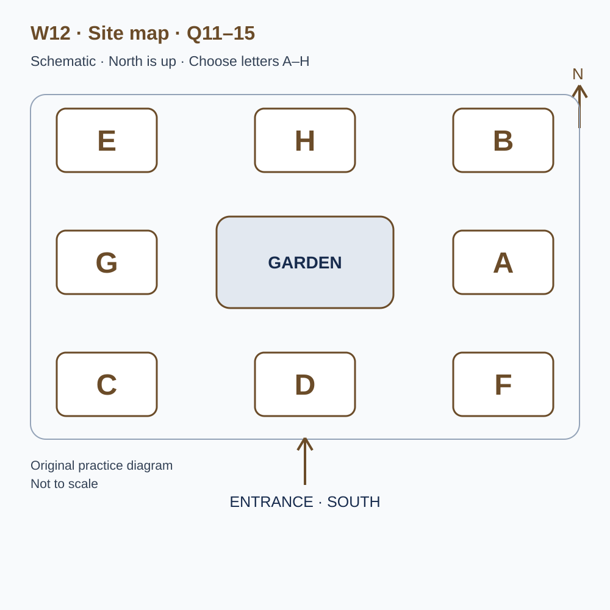
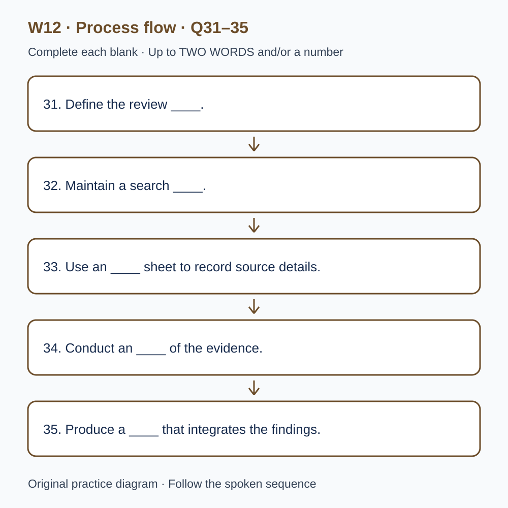

# L-W12 — Exhibitions, evidence and the next decision
> 原创 IELTS-style 技能练习，非真题、非标准化模考，不可换算正式分数。当前只有文字和题目，音频未生成，不能计作已完成听力套题。

共四部分、40 个计分空，每空 1 分。正式首次作答须等待批准音频，先不要打开 script.md 或 answers.md。朗读前先看题；只听一遍后提交首次答案及信心等级，再做精听。当前只能预览题面，不能把读稿作答记作听力成绩。

## Part 1 — Booking a community exhibition space

Q1–6: Complete the notes. Write **NO MORE THAN TWO WORDS AND/OR A NUMBER** for each answer, using words from the recording. Numeric notation may replace spoken numbers. Do not repeat a printed unit. Q7–10: Choose **ONE letter, A, B or C**.

**Q1.** Main display subject: ____

**Q2.** Confirmed day of November: ____

**Q3.** Allocated setup start (p.m.): ____

**Q4.** Number of tables: ____

**Q5.** Total confirmed fee: £____

**Q6.** Prepare ____ for loose activity pieces.

**Q7.** What presentation style is appropriate?

- A. A mandatory professional stage performance
- B. A clear short introduction for small-group conversations
- C. A long speech that every volunteer must memorise

Answer: ____

**Q8.** How should future-event contact details be collected?

- A. Through a separate optional sign-up with a clear purpose
- B. As a compulsory condition of doing the activity
- C. On every activity response sheet without explanation

Answer: ____

**Q9.** If visitors request a personal responsibility ranking, the group should

- A. claim the illustration proves every household difference
- B. avoid explaining any assumptions
- C. explain the evidence limits and what else would be needed

Answer: ____

**Q10.** How is the final location established?

- A. By any informal exchange between exhibitors
- B. By the numbered confirmation plan and direct revisions
- C. By the first layout on an early notice

Answer: ____

## Part 2 — Exhibition learning area

Q11–15: Label the map. Write **ONE letter, A–H**, for each destination. Three letters are unused. Q16–20: Choose **ONE letter, A, B or C**.

**Q11.** Check-in

Answer: ____

**Q12.** Demonstration area

Answer: ____

**Q13.** Quiet discussion area

Answer: ____

**Q14.** Feedback station

Answer: ____

**Q15.** Packaging collection area

Answer: ____

**Q16.** Why should the display heading be reviewed carefully?

- A. Visitors may remember its claim more than a small qualification
- B. Every heading must avoid a definite conclusion
- C. A dramatic heading creates evidence for its claim

Answer: ____

**Q17.** When a visitor gives an unexpected answer, facilitators should

- A. correct it immediately before hearing any explanation
- B. assume all unexpected answers show confusion
- C. ask neutrally how the visitor reached it

Answer: ____

**Q18.** Why log an explanation revised during the event?

- A. To create a diary of every unrelated conversation
- B. To distinguish responses produced under different versions
- C. To make all earlier responses disappear

Answer: ____

**Q19.** If an interactive element fails, the group should

- A. identify the equipment to support and label use of the alternative activity
- B. report only that a screen near some plants is broken
- C. combine alternative responses as if the original ran unchanged

Answer: ____

**Q20.** What should the final stage review include?

- A. Proof that every feature succeeded
- B. Only the most enthusiastic comments, generalised to all visitors
- C. Intentions, observations, uncertainties and a change to test

Answer: ____

## Part 3 — Reviewing an interactive display

Q21–26: Match each proposal to the students' **final** positions at the end of that exchange. The tutor is not included. Write **A, B, C or D**. Letters may be reused.

- **A** Amira only
- **B** Owen only
- **C** Both students
- **D** Neither student

Q27–28 and Q29–30: Choose **TWO different letters, A–E**, for each pair. Write one letter in each numbered slot; either order is accepted. Each distinct correct choice earns one point, maximum two. Repeating a letter cannot earn two points. Submit no more than two letters.

**Q21.** At the END of this exchange, who supports: Testing the display with people outside the course?

Answer: ____

**Q22.** At the END of this exchange, who supports: Putting the whole introduction on one screen?

Answer: ____

**Q23.** At the END of this exchange, who supports: Keeping written observer notes as well as the interaction log?

Answer: ____

**Q24.** At the END of this exchange, who supports: Publicly ranking visitors by completion speed?

Answer: ____

**Q25.** At the END of this exchange, who supports: Recording first-attempt completion time in this pilot?

Answer: ____

**Q26.** At the END of this exchange, who supports: Keeping a labelled revision log between sessions?

Answer: ____

**Q27–28.** Which TWO content changes are agreed after the first pilot?

- A. Add dramatic animation
- B. Add another organisation's logo
- C. Explain how the comparison was made
- D. Make missing values explicit
- E. Claim the display proves the cause

Answers: Q27 ____ · Q28 ____

**Q29–30.** Which TWO limitations belong in the pilot report?

- A. Only one venue was tested
- B. A shared folder was used
- C. The display never ran
- D. The colour scheme stayed the same
- E. Participants received different amounts of facilitator help

Answers: Q29 ____ · Q30 ____

## Part 4 — Building an evidence review

Q31–35: Complete the flow chart below. Q36–40: Complete the notes. Write **NO MORE THAN TWO WORDS AND/OR A NUMBER** for each answer, using words from the recording. Numeric notation may replace spoken numbers. Words or units already printed do not belong in the blank. The numbered text below repeats the SVG prompts for readability.

**Q31.** Define the review ____.

**Q32.** Maintain a search ____.

**Q33.** Use an ____ sheet to record source details.

**Q34.** Conduct an ____ of the evidence.

**Q35.** Produce a ____ that integrates the findings.

**Q36.** Prominent favourable findings may be easier to locate because of ____.

**Q37.** The term for important differences among included studies is ____.

**Q38.** Match recommendation strength to ____ in the relevant evidence.

**Q39.** Applying evidence across settings raises the issue of ____.

**Q40.** Create a ____ identifying the next action and main uncertainties.

## 本周训练安排（音频批准后执行）

- Preview questions without the script：8 分钟。
- Future continuous first listen, including planned part pauses：32 分钟。
- Submit first answers and confidence, without a second play：8 分钟。
- Check answers and classify errors：20 分钟。
- Four Q-located intensive segments, 15 minutes each：60 分钟。
- Diagram and opinion retelling：15 分钟。
- Next-day retry of missed items：15 分钟。

合计 **158 分钟**；最多另用 22 分钟缓冲，总计不超过 180 分钟。暂停、回放与查词均计入精听预算，不能另行无限追加。当前实际已完成听力分钟数为 0。精听区段和步骤见 intensive.md；答案和脚本另页。
