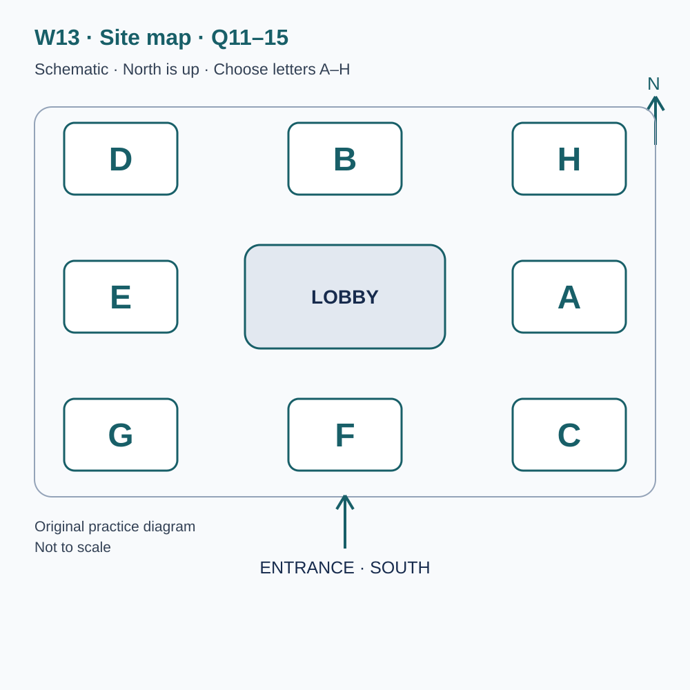
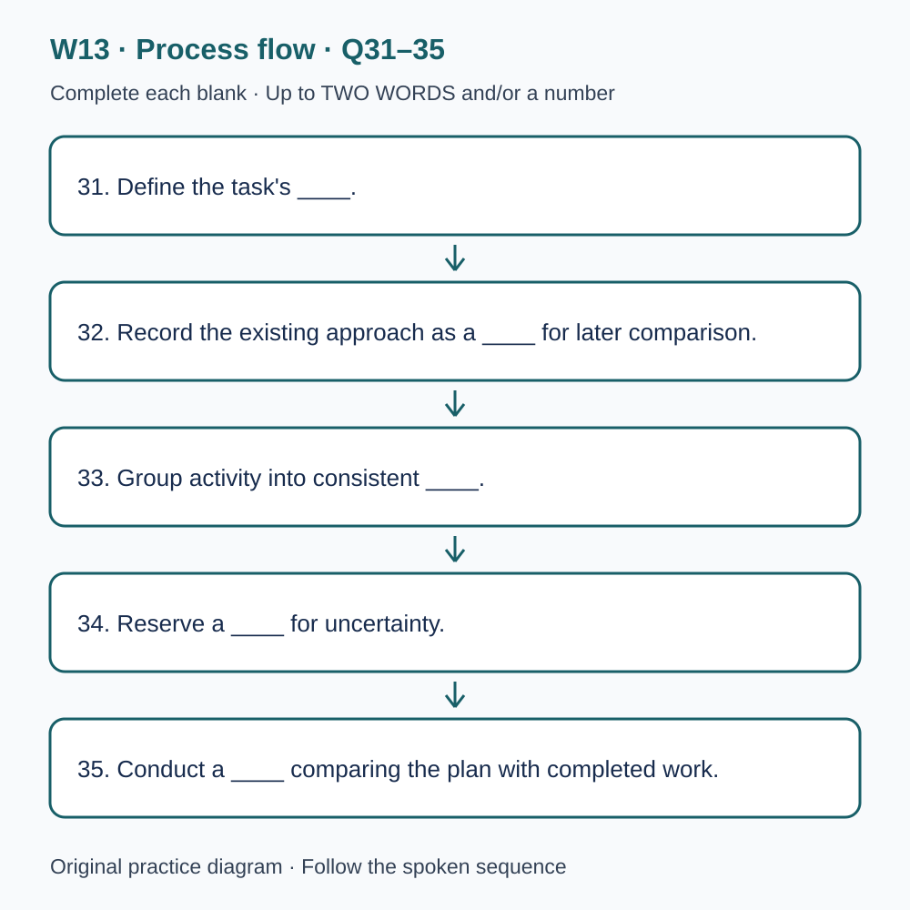

# L-W13 — Time, priorities and a workable plan

> 原创 IELTS-style 技能练习，非真题、非标准化模考，不可换算正式分数。当前只有文字和题目，音频未生成，不能计作已完成听力套题。

共四部分、40 个计分空，每空 1 分。正式首次作答须等待批准音频，先不要打开 script.md 或 answers.md。朗读前先看题；只听一遍后提交首次答案及信心等级，再做精听。当前只能预览题面，不能把读稿作答记作听力成绩。

## Part 1 — Booking a planning workshop

Q1–6: Complete the notes. Write **NO MORE THAN TWO WORDS AND/OR A NUMBER** for each answer, using words from the recording. Numeric notation may replace spoken numbers. Do not repeat a printed unit. Q7–10: Choose **ONE letter, A, B or C**.

**Q1.** Workshop selected: ____

**Q2.** Confirmed day of March: ____

**Q3.** Session start (a.m.): ____

**Q4.** Number of places: ____

**Q5.** Total booking charge: £____

**Q6.** Required planning document: ____

**Q7.** What does the workshop aim to do?

- A. Guarantee that every project finishes faster
- B. Help participants allocate work and recognise unrealistic plans
- C. Show how any amount of work fits into an afternoon

Answer: ____

**Q8.** How should the participant's access requirement be handled?

- A. Describe the practical requirement before the session
- B. Assume a front seat solves it
- C. Wait until the task begins

Answer: ____

**Q9.** What is included in the booking?

- A. A guaranteed full personal project consultation
- B. Unlimited extra time after the workshop
- C. A short group review; personal consultation is separate

Answer: ____

**Q10.** How should a routine booking change be made?

- A. By posting only in the public group
- B. By replying to the confirmation with its reference
- C. By sending a message to another participant

Answer: ____

## Part 2 — Learning hub orientation

Q11–15: Label the map. Write **ONE letter, A–H**, for each destination. Three letters are unused. Q16–20: Choose **ONE letter, A, B or C**.

**Q11.** Welcome desk

Answer: ____

**Q12.** Planning studio

Answer: ____

**Q13.** Individual practice booths

Answer: ____

**Q14.** Review room

Answer: ____

**Q15.** Printing point

Answer: ____

**Q16.** How should a timed activity be interpreted?

- A. According to its stated purpose, response and decisions
- B. As a race in which speed always means quality
- C. As proof that slower participants think more deeply

Answer: ____

**Q17.** What should participants do with an unclear instruction?

- A. Invent another requirement
- B. Use the clarification process and identify the actual requirements
- C. Ask the leader to make every substantive choice

Answer: ____

**Q18.** At the end of the agreed working period, participants should

- A. continue silently and report the original time
- B. hide any unfinished response
- C. follow the stop or marking instruction and record the conditions honestly

Answer: ____

**Q19.** What makes another participant's allocation advice useful?

- A. Copying the minutes regardless of the task
- B. Understanding the task and conditions behind the advice
- C. Assuming all familiar and unfamiliar tasks need equal time

Answer: ____

**Q20.** What should the final learning note identify?

- A. A specific change to test and its supporting evidence
- B. Only the phrase better time management
- C. Every possible weakness to change immediately

Answer: ____

## Part 3 — Reviewing a timed-task pilot

Q21–26: Match each proposal to the students' **final** positions at the end of that exchange. The tutor is not included. Write **A, B, C or D**. Letters may be reused.

- **A** Jade only
- **B** Leo only
- **C** Both students
- **D** Neither student

Q27–28 and Q29–30: Choose **TWO different letters, A–E**, for each pair. Write one letter in each numbered slot; either order is accepted. Each distinct correct choice earns one point, maximum two. Repeating a letter cannot earn two points. Submit no more than two letters.

**Q21.** At the END of this exchange, who supports: Using short work blocks with a purpose for each?

Answer: ____

**Q22.** At the END of this exchange, who supports: Stopping immediately at every block alarm in the next practice?

Answer: ____

**Q23.** At the END of this exchange, who supports: Reserving a separate buffer at the end?

Answer: ____

**Q24.** At the END of this exchange, who supports: Tracking every minute during the task?

Answer: ____

**Q25.** At the END of this exchange, who supports: Estimating stage time after reading the requirements?

Answer: ____

**Q26.** At the END of this exchange, who supports: Checking an unclear instruction aloud with a partner?

Answer: ____

**Q27–28.** Which TWO preparation actions are agreed?

- A. Underline every sentence
- B. Identify instruction verbs
- C. Begin with a decorative introduction
- D. Mark each required output
- E. Predict the eventual score

Answers: Q27 ____ · Q28 ____

**Q29–30.** Which TWO limitations affect the completed pilot?

- A. It covered only one afternoon
- B. The session was cancelled
- C. Paper records were inherently unreliable
- D. The room was unavailable
- E. The tasks differed in difficulty

Answers: Q29 ____ · Q30 ____

## Part 4 — Investigating how study time is used

Q31–35: Complete the flow chart below. Q36–40: Complete the notes. Write **NO MORE THAN TWO WORDS AND/OR A NUMBER** for each answer, using words from the recording. Numeric notation may replace spoken numbers. Words or units already printed do not belong in the blank. The numbered text below repeats the SVG prompts for readability.

**Q31.** Define the task's ____.

**Q32.** Record the existing approach as a ____ for later comparison.

**Q33.** Group activity into consistent ____.

**Q34.** Reserve a ____ for uncertainty.

**Q35.** Conduct a ____ comparing the plan with completed work.

**Q36.** Record how ____ occur and how work resumes.

**Q37.** Task ____ can be purposeful rather than a planning failure.

**Q38.** ____ may influence a later task in a demanding sequence.

**Q39.** Time predictions should acknowledge ____.

**Q40.** Using a routine across different tasks raises the question of ____.

## 本周训练安排（音频批准后执行）

- Preview questions without the script：8 分钟。
- Future continuous first listen, including planned part pauses：32 分钟。
- Submit first answers and confidence, without a second play：8 分钟。
- Check answers and classify errors：20 分钟。
- Four Q-located intensive segments, 15 minutes each：60 分钟。
- Diagram and opinion retelling：15 分钟。
- Next-day retry of missed items：15 分钟。

合计 **158 分钟**；最多另用 22 分钟缓冲，总计不超过 180 分钟。暂停、回放与查词均计入精听预算，不能另行无限追加。当前实际已完成听力分钟数为 0。精听区段和步骤见 intensive.md；答案和脚本另页。
