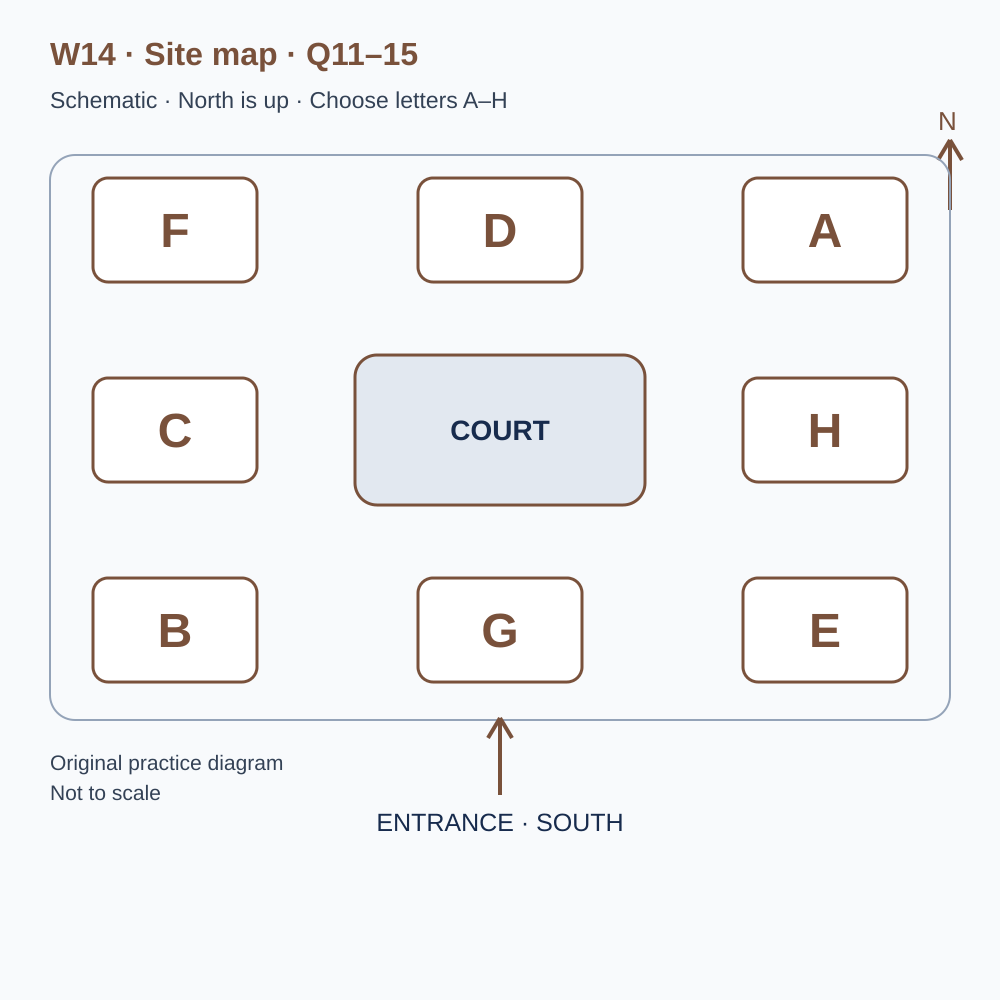
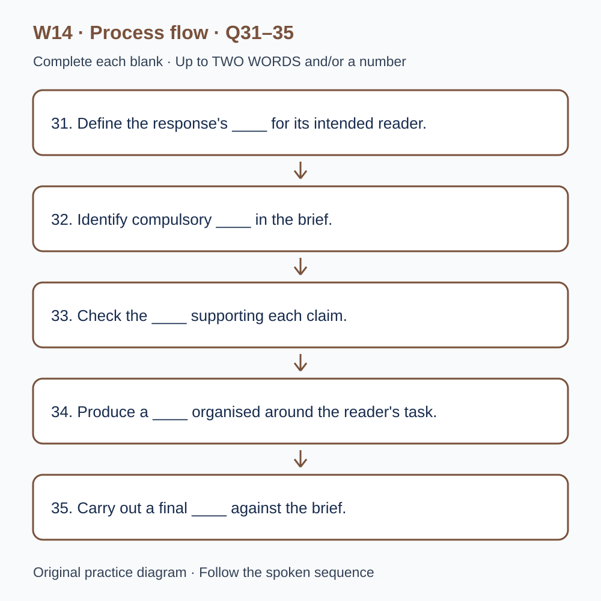

# L-W14 — Answering the brief without exceeding the evidence

> 原创 IELTS-style 技能练习，非真题、非标准化模考，不可换算正式分数。当前只有文字和题目，音频未生成，不能计作已完成听力套题。

共四部分、40 个计分空，每空 1 分。正式首次作答须等待批准音频，先不要打开 script.md 或 answers.md。朗读前先看题；只听一遍后提交首次答案及信心等级，再做精听。当前只能预览题面，不能把读稿作答记作听力成绩。

## Part 1 — Booking a communication workshop

Q1–6: Complete the notes. Write **NO MORE THAN TWO WORDS AND/OR A NUMBER** for each answer, using words from the recording. Numeric notation may replace spoken numbers. Do not repeat a printed unit. Q7–10: Choose **ONE letter, A, B or C**.

**Q1.** Workshop selected: ____

**Q2.** Confirmed day of June: ____

**Q3.** Teaching start (p.m.): ____

**Q4.** Number of places: ____

**Q5.** Total group fee: £____

**Q6.** Essential document to bring: ____

**Q7.** What should participants expect from the workshop?

- A. A commissioned complete rewrite
- B. Support in making and explaining their own revisions
- C. A guaranteed finished publication

Answer: ____

**Q8.** Which photographs should the group bring?

- A. Material it may use for the intended purpose, with conditions clear
- B. Any private image that makes the page attractive
- C. Images assumed cleared for every later use by workshop attendance

Answer: ____

**Q9.** How should a digital-format requirement be discussed?

- A. Assume a larger printed sheet is the only option
- B. Assume every alternative is guaranteed
- C. Describe the practical format need in advance

Answer: ____

**Q10.** Which joining instructions should the group use?

- A. A combination of convenient details from old versions
- B. The current numbered confirmation and direct revision
- C. The first public notice regardless of later updates

Answer: ____

## Part 2 — Design centre orientation

Q11–15: Label the map. Write **ONE letter, A–H**, for each destination. Three letters are unused. Q16–20: Choose **ONE letter, A, B or C**.

**Q11.** Reception

Answer: ____

**Q12.** Briefing room

Answer: ____

**Q13.** Sample display

Answer: ____

**Q14.** Reader-testing room

Answer: ____

**Q15.** Resource collection point

Answer: ____

**Q16.** What should participants distinguish in a brief?

- A. Compulsory requirements from possible suggestions
- B. Every example as a compulsory instruction
- C. Requirements as optional design preferences

Answer: ____

**Q17.** What should determine the allocation of page space?

- A. The amount of interesting history available
- B. The intended reader and action
- C. A rule that every section must have equal length

Answer: ____

**Q18.** If a figure lacks a reliable source, the team should

- A. invent a plausible number
- B. hide the gap to complete the page
- C. mark the gap and qualify, remove or investigate the claim

Answer: ____

**Q19.** What should happen after a reader opens the wrong section?

- A. Assume the heading caused it
- B. Record the action and ask a neutral follow-up
- C. Tell the reader what criticism the team wants

Answer: ____

**Q20.** What belongs in the final review?

- A. A comparison with the brief and a record of remaining limitations
- B. A declaration that improved appearance means completion
- C. Only spelling changes, regardless of missing outputs

Answer: ____

## Part 3 — Reviewing a public-information draft

Q21–26: Match each proposal to the students' **final** positions at the end of that exchange. The tutor is not included. Write **A, B, C or D**. Letters may be reused.

- **A** Saira only
- **B** Tom only
- **C** Both students
- **D** Neither student

Q27–28 and Q29–30: Choose **TWO different letters, A–E**, for each pair. Write one letter in each numbered slot; either order is accepted. Each distinct correct choice earns one point, maximum two. Repeating a letter cannot earn two points. Submit no more than two letters.

**Q21.** At the END of this exchange, who supports: Including every fact in the background pack?

Answer: ____

**Q22.** At the END of this exchange, who supports: Stating the intended audience explicitly?

Answer: ____

**Q23.** At the END of this exchange, who supports: Using an invented attendance figure as an established fact?

Answer: ____

**Q24.** At the END of this exchange, who supports: Requesting clarification of the length criterion before revision?

Answer: ____

**Q25.** At the END of this exchange, who supports: Adding a short opening summary?

Answer: ____

**Q26.** At the END of this exchange, who supports: Keeping a nearby uncertainty label with shortened wording if appropriate?

Answer: ____

**Q27–28.** Which TWO revision checks are agreed?

- A. Use all supplied background notes
- B. Add an unrequested decorative chart
- C. Separate requirements from suggestions
- D. Link each section to a stated criterion
- E. Predict a formal score for each section

Answers: Q27 ____ · Q28 ____

**Q29–30.** Which TWO limitations affect the reader sessions?

- A. Volunteers were not from the intended audience
- B. Black-and-white printing necessarily made the task invalid
- C. The testing room was unavailable
- D. Both sessions were cancelled
- E. The client changed the brief between sessions

Answers: Q29 ____ · Q30 ____

## Part 4 — Turning a brief into a justified response

Q31–35: Complete the flow chart below. Q36–40: Complete the notes. Write **NO MORE THAN TWO WORDS AND/OR A NUMBER** for each answer, using words from the recording. Numeric notation may replace spoken numbers. Words or units already printed do not belong in the blank. The numbered text below repeats the SVG prompts for readability.

**Q31.** Define the response's ____ for its intended reader.

**Q32.** Identify compulsory ____ in the brief.

**Q33.** Check the ____ supporting each claim.

**Q34.** Produce a ____ organised around the reader's task.

**Q35.** Carry out a final ____ against the brief.

**Q36.** Information's connection to the task is its ____.

**Q37.** The relative attention given to points concerns ____.

**Q38.** Record key ____ that affect the response.

**Q39.** State the ____ on what the evidence can establish.

**Q40.** Plan a ____ to check whether the revision worked.

## 本周训练安排（音频批准后执行）

- Preview questions without the script：8 分钟。
- Future continuous first listen, including planned part pauses：32 分钟。
- Submit first answers and confidence, without a second play：8 分钟。
- Check answers and classify errors：20 分钟。
- Four Q-located intensive segments, 15 minutes each：60 分钟。
- Diagram and opinion retelling：15 分钟。
- Next-day retry of missed items：15 分钟。

合计 **158 分钟**；最多另用 22 分钟缓冲，总计不超过 180 分钟。暂停、回放与查词均计入精听预算，不能另行无限追加。当前实际已完成听力分钟数为 0。精听区段和步骤见 intensive.md；答案和脚本另页。
