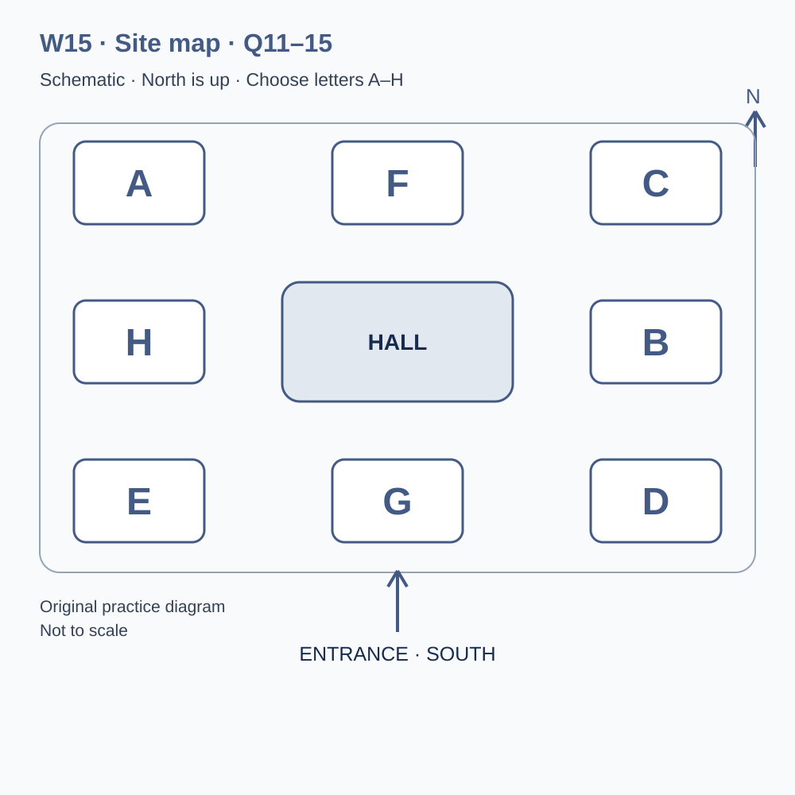
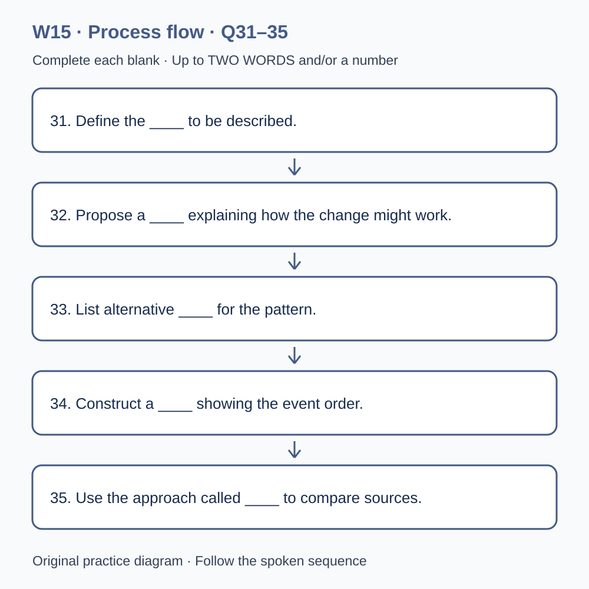

# L-W15 — Comparing change and competing explanations

> 原创 IELTS-style 技能练习，非真题、非标准化模考，不可换算正式分数。当前只有文字和题目，音频未生成，不能计作已完成听力套题。

共四部分、40 个计分空，每空 1 分。正式首次作答须等待批准音频，先不要打开 script.md 或 answers.md。朗读前先看题；只听一遍后提交首次答案及信心等级，再做精听。当前只能预览题面，不能把读稿作答记作听力成绩。

## Part 1 — Arranging a data clinic visit

Q1–6: Complete the notes. Write **NO MORE THAN TWO WORDS AND/OR A NUMBER** for each answer, using words from the recording. Numeric notation may replace spoken numbers. Do not repeat a printed unit. Q7–10: Choose **ONE letter, A, B or C**.

**Q1.** Main data topic: ____

**Q2.** Confirmed day of September: ____

**Q3.** Clinic start (a.m.): ____

**Q4.** Number of participants: ____

**Q5.** Total booking fee: £____

**Q6.** Bring a ____ of the data, not personal original records.

**Q7.** What can the clinic offer regarding the shorter waits?

- A. A guaranteed causal answer from any figures
- B. Help examining the question and the limits of the design
- C. Proof that the preferred explanation is correct

Answer: ____

**Q8.** What is needed for another organisation's comparison material?

- A. Permission for the use and a clear description of its meaning
- B. Only a similar table title
- C. A private copy without checking conditions

Answer: ____

**Q9.** How should the reading-software requirement be handled?

- A. Assume a worksheet photograph is equivalent to an accessible file
- B. Wait until teaching begins
- C. Describe the format requirement before attendance

Answer: ____

**Q10.** What updates the clinic attendance record?

- A. A public programme comment only
- B. A reply with the booking reference
- C. An informal message between participants

Answer: ____

## Part 2 — Research centre orientation

Q11–15: Label the map. Write **ONE letter, A–H**, for each destination. Three letters are unused. Q16–20: Choose **ONE letter, A, B or C**.

**Q11.** Reception

Answer: ____

**Q12.** Methods room

Answer: ____

**Q13.** Dataset desk

Answer: ____

**Q14.** Discussion room

Answer: ____

**Q15.** Checkout desk

Answer: ____

**Q16.** What distinguishes a causal explanation from a description?

- A. It claims a particular change produced the observed difference
- B. It merely repeats the recorded numbers
- C. It requires no reasoning beyond a shorter wait

Answer: ____

**Q17.** Before comparing waiting times, participants should

- A. assume matching column titles mean matching definitions
- B. inspect the start and end definitions
- C. calculate a precise difference before checking what was measured

Answer: ____

**Q18.** How should a missing wait be handled?

- A. As zero automatically
- B. As the longest observed wait automatically
- C. As missing, with any analytical treatment made explicit

Answer: ____

**Q19.** What helps distinguish competing explanations?

- A. Repeating the shorter-wait figure more confidently
- B. Identifying observations that bear on each explanation
- C. Assuming a group must agree immediately

Answer: ____

**Q20.** What three things belong in the closing review?

- A. A supported finding, an unresolved explanation and a next step
- B. A claim that the planned comparison has already happened
- C. A mechanism treated as proof of the outcome

Answer: ____

## Part 3 — Reviewing a service pilot

Q21–26: Match each proposal to the students' **final** positions at the end of that exchange. The tutor is not included. Write **A, B, C or D**. Letters may be reused.

- **A** Nora only
- **B** Eli only
- **C** Both students
- **D** Neither student

Q27–28 and Q29–30: Choose **TWO different letters, A–E**, for each pair. Write one letter in each numbered slot; either order is accepted. Each distinct correct choice earns one point, maximum two. Repeating a letter cannot earn two points. Submit no more than two letters.

**Q21.** At the END of this exchange, who supports: Adding an exploratory comparison venue to the next pilot?

Answer: ____

**Q22.** At the END of this exchange, who supports: Recording staffing actually available during each session?

Answer: ____

**Q23.** At the END of this exchange, who supports: Extending the observation period in the next stage?

Answer: ____

**Q24.** At the END of this exchange, who supports: Collecting visitors' full names on the analysis sheet?

Answer: ____

**Q25.** At the END of this exchange, who supports: Using matched time windows at the two venues?

Answer: ____

**Q26.** At the END of this exchange, who supports: Labelling descriptive findings separately from causal claims?

Answer: ____

**Q27–28.** Which TWO additional records are selected for each interval?

- A. Staff names
- B. The number of active service points
- C. Prices of visitors' recent purchases
- D. The number of arrivals
- E. Visitors' full addresses

Answers: Q27 ____ · Q28 ____

**Q29–30.** Which TWO changes occurred together in the completed pilot?

- A. The desk layout changed
- B. The timer failed
- C. The service was cancelled
- D. An entire session's records were absent
- E. The appointment rule changed

Answers: Q29 ____ · Q30 ____

## Part 4 — Building a cautious causal comparison

Q31–35: Complete the flow chart below. Q36–40: Complete the notes. Write **NO MORE THAN TWO WORDS AND/OR A NUMBER** for each answer, using words from the recording. Numeric notation may replace spoken numbers. Words or units already printed do not belong in the blank. The numbered text below repeats the SVG prompts for readability.

**Q31.** Define the ____ to be described.

**Q32.** Propose a ____ explaining how the change might work.

**Q33.** List alternative ____ for the pattern.

**Q34.** Construct a ____ showing the event order.

**Q35.** Use the approach called ____ to compare sources.

**Q36.** Group ____ can influence a comparison before the intervention.

**Q37.** Check whether ____ procedures changed between periods.

**Q38.** Dependence between combined changes is described here as ____.

**Q39.** The ____ concerns what would have happened without the change.

**Q40.** Repeat the defined method in a planned ____.

## 本周训练安排（音频批准后执行）

- Preview questions without the script：8 分钟。
- Future continuous first listen, including planned part pauses：32 分钟。
- Submit first answers and confidence, without a second play：8 分钟。
- Check answers and classify errors：20 分钟。
- Four Q-located intensive segments, 15 minutes each：60 分钟。
- Diagram and opinion retelling：15 分钟。
- Next-day retry of missed items：15 分钟。

合计 **158 分钟**；最多另用 22 分钟缓冲，总计不超过 180 分钟。暂停、回放与查词均计入精听预算，不能另行无限追加。当前实际已完成听力分钟数为 0。精听区段和步骤见 intensive.md；答案和脚本另页。
