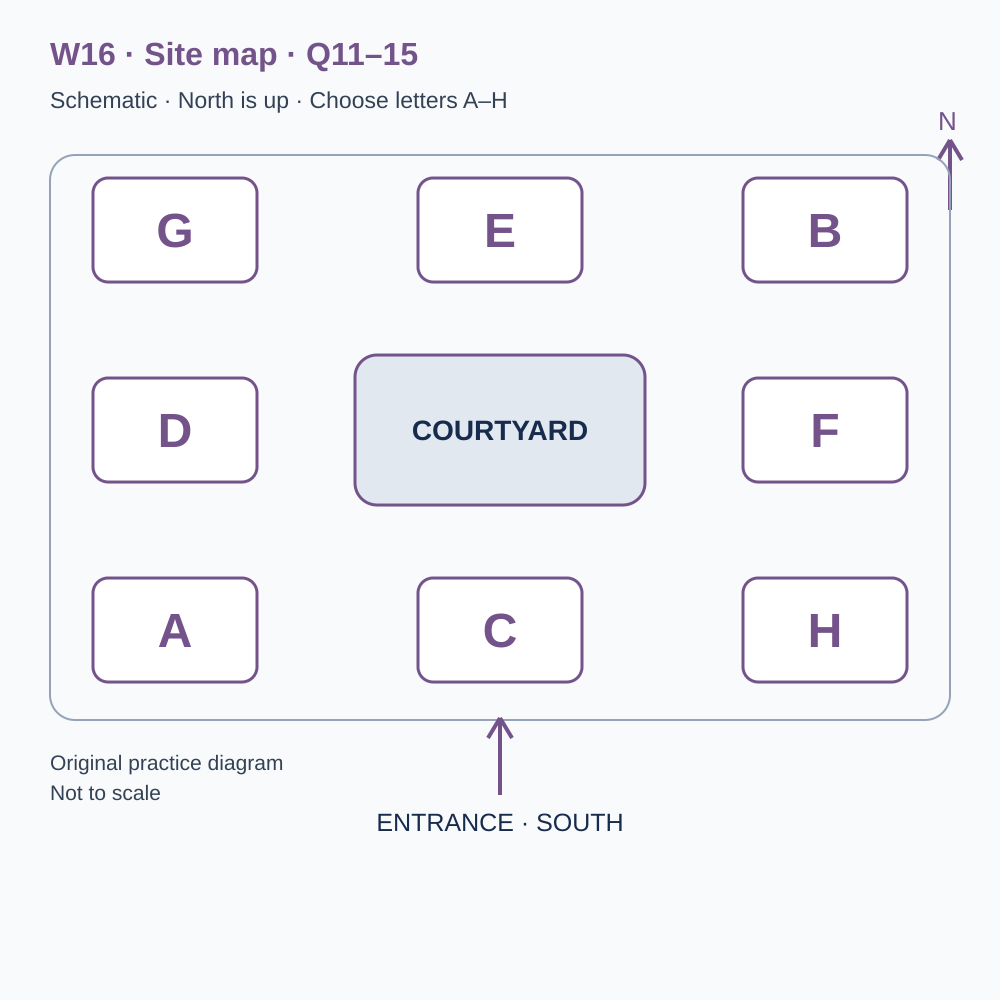
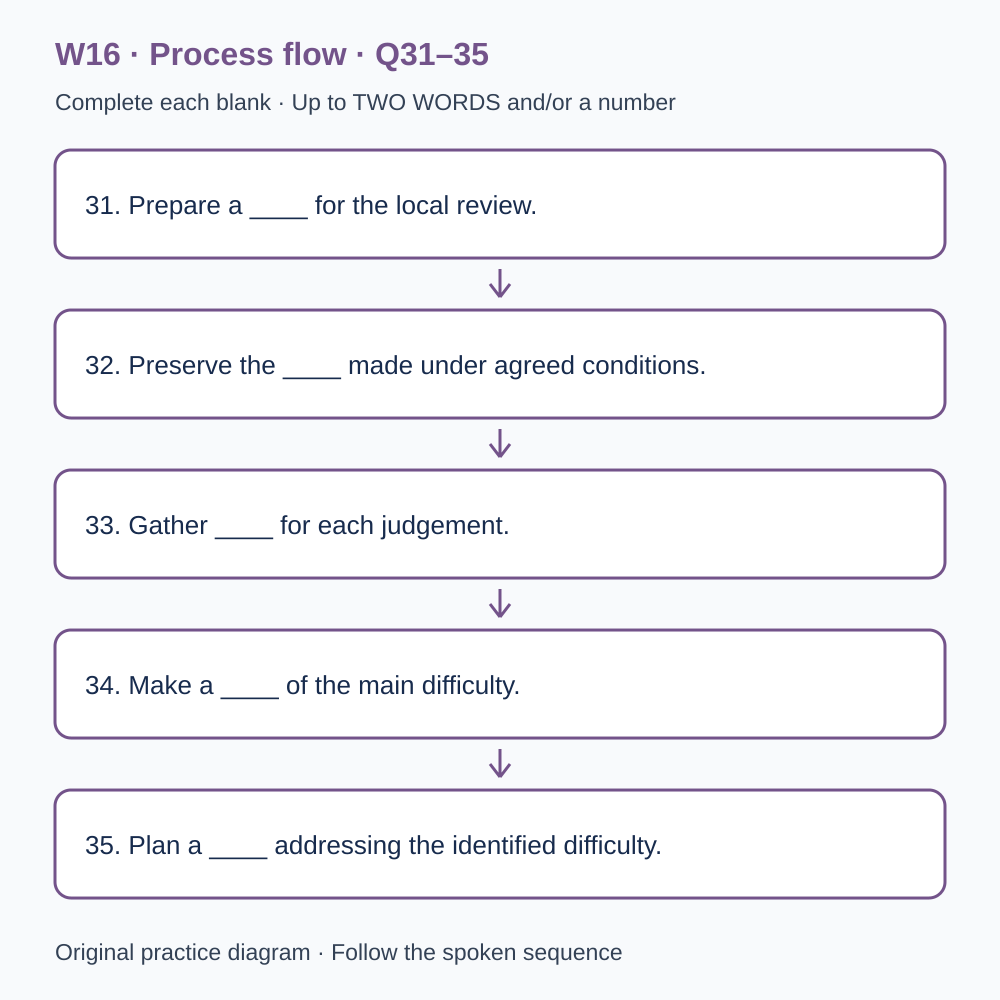

# L-W16 — An original checkpoint and the next learning decision
> W16 是原创阶段检查，不能替代正式 T16，也不能据本练习换算官方分数。

> 原创 IELTS-style 技能练习，非真题、非标准化模考，不可换算正式分数。当前只有文字和题目，音频未生成，不能计作已完成听力套题。

共四部分、40 个计分空，每空 1 分。正式首次作答须等待批准音频，先不要打开 script.md 或 answers.md。朗读前先看题；只听一遍后提交首次答案及信心等级，再做精听。当前只能预览题面，不能把读稿作答记作听力成绩。

## Part 1 — Booking a progress workshop

Q1–6: Complete the notes. Write **NO MORE THAN TWO WORDS AND/OR A NUMBER** for each answer, using words from the recording. Numeric notation may replace spoken numbers. Do not repeat a printed unit. Q7–10: Choose **ONE letter, A, B or C**.

**Q1.** Workshop selected: ____

**Q2.** Confirmed day of November: ____

**Q3.** Workshop start (p.m.): ____

**Q4.** Number of confirmed places: ____

**Q5.** Total booking cost: £____

**Q6.** Practice record to bring: ____

**Q7.** What is the workshop activity?

- A. An original learning review, not a formal examination
- B. A guaranteed official score assessment
- C. A replacement for any separately required formal checkpoint

Answer: ____

**Q8.** Before comparing practice scores, learners should

- A. treat every increase as proven learning
- B. check tasks, timing and help received
- C. discard all lower totals without examining the work

Answer: ____

**Q9.** What should happen with a format requirement?

- A. Guess on the partner's behalf
- B. Assume only standard print exists
- C. Discuss the practical need before the workshop

Answer: ____

**Q10.** How should a booking change be reported?

- A. Through the confirmation reference and its designated contact route
- B. Through public comments alone
- C. By retaining only a screenshot of the start time

Answer: ____

## Part 2 — Learning review centre orientation

Q11–15: Label the map. Write **ONE letter, A–H**, for each destination. Three letters are unused. Q16–20: Choose **ONE letter, A, B or C**.

**Q11.** Check-in

Answer: ____

**Q12.** Individual practice room

Answer: ____

**Q13.** Discussion room

Answer: ____

**Q14.** Review room

Answer: ____

**Q15.** Printed-resource collection point

Answer: ____

**Q16.** How should the original checkpoint result be used?

- A. As an official band conversion
- B. As evidence for specific next learning decisions
- C. As a substitute for all formal assessment requirements

Answer: ____

**Q17.** What should learners identify before starting?

- A. Every possible optional addition
- B. Only the maximum amount they can write
- C. Required outputs and what the stated limit includes

Answer: ____

**Q18.** Why preserve the first response separately?

- A. It shows the difficulty before correction or feedback
- B. It proves revisions were unaided
- C. It makes help received irrelevant

Answer: ____

**Q19.** How should confidence ratings be interpreted?

- A. As substitutes for supporting evidence
- B. Alongside answers and the reasons behind the rating
- C. As a rule that high confidence deserves praise regardless of accuracy

Answer: ____

**Q20.** What makes the closing plan useful?

- A. Trying to change every weakness at once
- B. Promising a score before the next attempt
- C. Naming a manageable priority and a later way to check it

Answer: ____

## Part 3 — Interpreting two practice attempts

Q21–26: Match each proposal to the students' **final** positions at the end of that exchange. The tutor is not included. Write **A, B, C or D**. Letters may be reused.

- **A** Mina only
- **B** Caleb only
- **C** Both students
- **D** Neither student

Q27–28 and Q29–30: Choose **TWO different letters, A–E**, for each pair. Write one letter in each numbered slot; either order is accepted. Each distinct correct choice earns one point, maximum two. Repeating a letter cannot earn two points. Submit no more than two letters.

**Q21.** At the END of this exchange, who supports: Reviewing missed required outputs before other details?

Answer: ____

**Q22.** At the END of this exchange, who supports: Timing the first planning stage separately next time?

Answer: ____

**Q23.** At the END of this exchange, who supports: Converting the local total into an official band?

Answer: ____

**Q24.** At the END of this exchange, who supports: Adding a short follow-up on uncertain interpretations in the next session?

Answer: ____

**Q25.** At the END of this exchange, who supports: Checking task and support conditions before comparing attempts?

Answer: ____

**Q26.** At the END of this exchange, who supports: Adding confidence ratings with reasons beside first answers?

Answer: ____

**Q27–28.** Which TWO indicators are agreed for the review?

- A. Total word count as the main measure
- B. Required-output coverage
- C. A neatness ranking
- D. Evidence traceability for main claims
- E. An official score forecast

Answers: Q27 ____ · Q28 ____

**Q29–30.** Which TWO limitations affect the comparison of attempts?

- A. The second task was more familiar
- B. Both original responses were saved
- C. A session was cancelled
- D. Participants received unequal assistance
- E. Pages were missing

Answers: Q29 ____ · Q30 ____

## Part 4 — From a checkpoint to a revised learning plan

Q31–35: Complete the flow chart below. Q36–40: Complete the notes. Write **NO MORE THAN TWO WORDS AND/OR A NUMBER** for each answer, using words from the recording. Numeric notation may replace spoken numbers. Words or units already printed do not belong in the blank. The numbered text below repeats the SVG prompts for readability.

**Q31.** Prepare a ____ for the local review.

**Q32.** Preserve the ____ made under agreed conditions.

**Q33.** Gather ____ for each judgement.

**Q34.** Make a ____ of the main difficulty.

**Q35.** Plan a ____ addressing the identified difficulty.

**Q36.** Check ____ after a delay.

**Q37.** Using learning in a different task or setting is ____.

**Q38.** The relationship between confidence and accuracy is ____.

**Q39.** Select a small number of ____ for the next period.

**Q40.** Arrange a ____ to review the next attempt.

## 本周训练安排（音频批准后执行）

- Preview questions without the script：8 分钟。
- Future continuous first listen, including planned part pauses：32 分钟。
- Submit first answers and confidence, without a second play：8 分钟。
- Check answers and classify errors：20 分钟。
- Four Q-located intensive segments, 15 minutes each：60 分钟。
- Diagram and opinion retelling：15 分钟。
- Next-day retry of missed items：15 分钟。

合计 **158 分钟**；最多另用 22 分钟缓冲，总计不超过 180 分钟。暂停、回放与查词均计入精听预算，不能另行无限追加。当前实际已完成听力分钟数为 0。精听区段和步骤见 intensive.md；答案和脚本另页。
