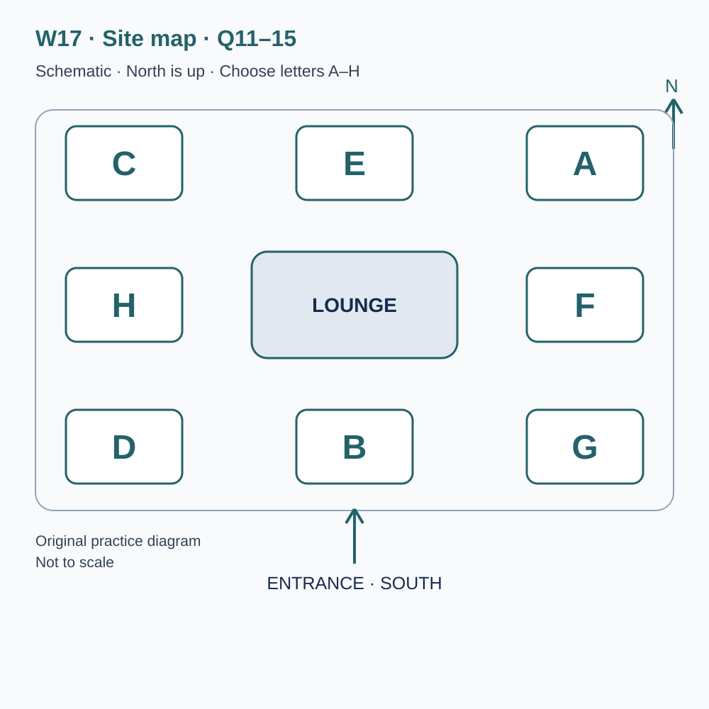
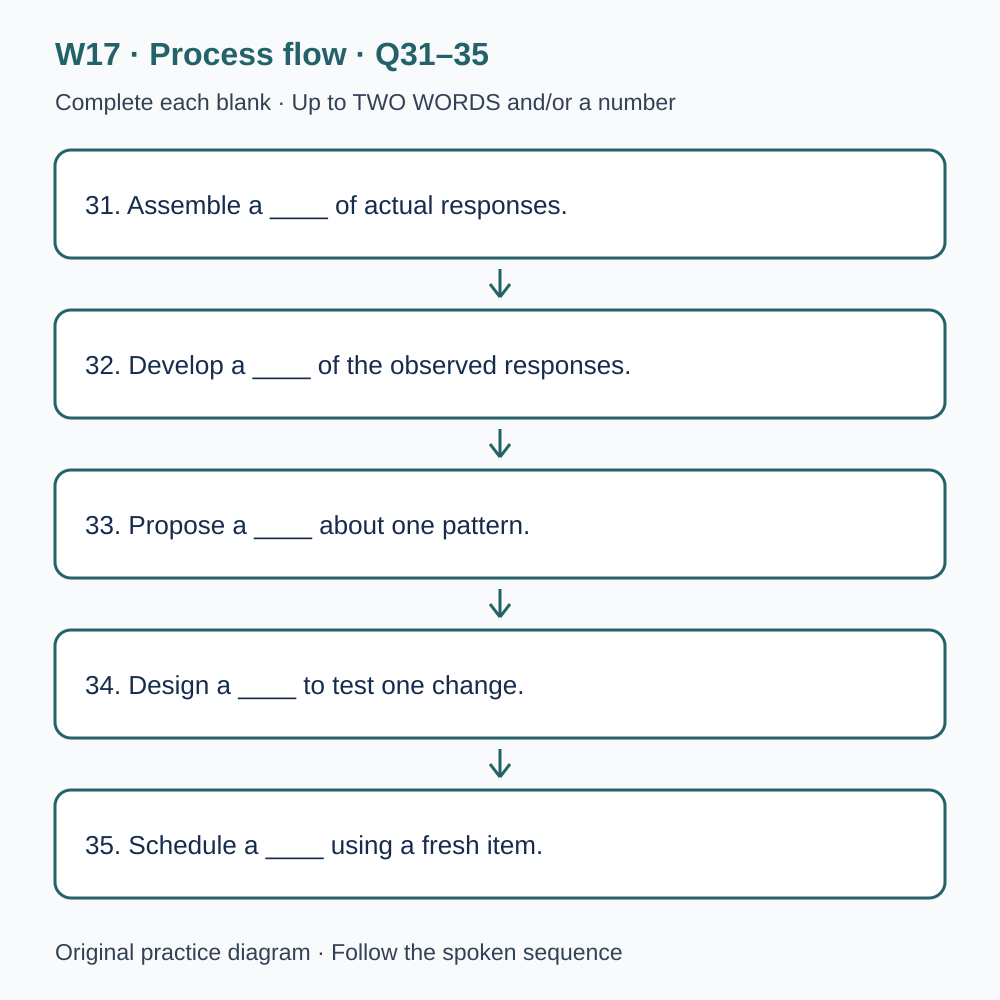

# L-W17 — From recorded errors to a testable practice decision

> 原创 IELTS-style 技能练习，非真题、非标准化模考，不可换算正式分数。当前只有文字和题目，音频未生成，不能计作已完成听力套题。

共四部分、40 个计分空，每空 1 分。正式首次作答须等待批准音频，先不要打开 script.md 或 answers.md。朗读前先看题；只听一遍后提交首次答案及信心等级，再做精听。当前只能预览题面，不能把读稿作答记作听力成绩。

## Part 1 — Booking an evidence review

Q1–6: Complete the notes. Write **NO MORE THAN TWO WORDS AND/OR A NUMBER** for each answer, using words from the recording. Numeric notation may replace spoken numbers. Do not repeat a printed unit. Q7–10: Choose **ONE letter, A, B or C**.

**Q1.** Workshop selected: ____

**Q2.** Confirmed day of May: ____

**Q3.** Teaching start (a.m.): ____

**Q4.** Number of places: ____

**Q5.** Total group charge: £____

**Q6.** Essential document, if the first response survives: ____

**Q7.** What can the leader conclude about a participant?

- A. A general weakness from attendance alone
- B. A complete error profile from a total
- C. Only observations supported by the available records

Answer: ____

**Q8.** What should happen to unanswered spaces?

- A. Fill them before the review
- B. Preserve them in the first response
- C. Copy the corrected version over them

Answer: ____

**Q9.** How should the reading-application requirement be handled?

- A. Describe the format need in advance
- B. Assume a worksheet photograph is equivalent
- C. Hide the arrangement from the practice record

Answer: ____

**Q10.** How should a routine attendance change be reported?

- A. By public comment alone
- B. Through an absent group member
- C. By replying to the confirmation with its reference

Answer: ____

## Part 2 — Finding the review facilities

Q11–15: Label the map. Write **ONE letter, A–H**, for each destination. Three letters are unused. Q16–20: Choose **ONE letter, A, B or C**.

**Q11.** Check-in desk

Answer: ____

**Q12.** Records room

Answer: ____

**Q13.** Comparison room

Answer: ____

**Q14.** Consultation room

Answer: ____

**Q15.** Worksheet collection point

Answer: ____

**Q16.** What should the opening review begin with?

- A. A permanent label for the learner
- B. The first response compared with the stated requirement
- C. A guessed cause for every error

Answer: ____

**Q17.** If the earlier response is missing, participants should

- A. reconstruct it from the total
- B. use a fictional example as personal evidence
- C. record the gap and plan appropriate collection

Answer: ____

**Q18.** Before comparing scores, the group should

- A. check and consistently apply the stated scoring rule
- B. award two points for a repeated correct letter
- C. silently change ambiguous rules for one participant

Answer: ____

**Q19.** How should shared responses be identified?

- A. By displaying every personal detail
- B. By changing the code on each page
- C. By a consistent code linking the relevant records

Answer: ____

**Q20.** What makes the closing plan appropriate?

- A. Giving every participant the same weakness
- B. Choosing an action or evidence collection justified by the record
- C. Treating one error as a permanent inability

Answer: ____

## Part 3 — Choosing the next practice trial

Q21–26: Match each proposal to the students' **final** positions at the end of that exchange. The tutor is not included. Write **A, B, C or D**. Letters may be reused.

- **A** Iris only
- **B** Owen only
- **C** Both students
- **D** Neither student

Q27–28 and Q29–30: Choose **TWO different letters, A–E**, for each pair. Write one letter in each numbered slot; either order is accepted. Each distinct correct choice earns one point, maximum two. Repeating a letter cannot earn two points. Submit no more than two letters.

**Q21.** At the END of this exchange, who supports: Selecting one observed error pattern as the next focus?

Answer: ____

**Q22.** At the END of this exchange, who supports: Preserving the first response before annotation?

Answer: ____

**Q23.** At the END of this exchange, who supports: Recording time spent reading the instruction in the next trial?

Answer: ____

**Q24.** At the END of this exchange, who supports: Classifying every blank as carelessness?

Answer: ____

**Q25.** At the END of this exchange, who supports: Using a fresh task for the very next check?

Answer: ____

**Q26.** At the END of this exchange, who supports: Keeping more than one plausible explanation in the record?

Answer: ____

**Q27–28.** Which TWO preparation steps are agreed?

- A. Compare responses with requirements and evidence
- B. Rank participants by their totals
- C. Rewrite the first answers immediately
- D. Preserve relevant attempt conditions
- E. Forecast official scores

Answers: Q27 ____ · Q28 ____

**Q29–30.** Which TWO limitations affected the completed review?

- A. All response pages were missing
- B. Only a narrow range of tasks was represented
- C. The room was unavailable
- D. The sessions were cancelled
- E. Participants had unequal replay opportunities

Answers: Q29 ____ · Q30 ____

## Part 4 — Evaluating a proposed improvement

Q31–35: Complete the flow chart below. Q36–40: Complete the notes. Write **NO MORE THAN TWO WORDS AND/OR A NUMBER** for each answer, using words from the recording. Numeric notation may replace spoken numbers. Words or units already printed do not belong in the blank. The numbered text below repeats the SVG prompts for readability.

**Q31.** Assemble a ____ of actual responses.

**Q32.** Develop a ____ of the observed responses.

**Q33.** Propose a ____ about one pattern.

**Q34.** Design a ____ to test one change.

**Q35.** Schedule a ____ using a fresh item.

**Q36.** Preserve the ____ of each response.

**Q37.** State the ____ when calculating an error rate.

**Q38.** A rating taken before feedback records the learner's ____.

**Q39.** Availability of learning after a delay concerns ____.

**Q40.** Using learning when the task changes concerns ____.

## 本周训练安排（音频批准后执行）

- Preview questions without the script：8 分钟。
- Future continuous first listen, including planned part pauses：32 分钟。
- Submit first answers and confidence, without a second play：8 分钟。
- Check answers and classify errors：20 分钟。
- Four Q-located intensive segments, 15 minutes each：60 分钟。
- Diagram and opinion retelling：15 分钟。
- Next-day retry of missed items：15 分钟。

合计 **158 分钟**；最多另用 22 分钟缓冲，总计不超过 180 分钟。暂停、回放与查词均计入精听预算，不能另行无限追加。当前实际已完成听力分钟数为 0。精听区段和步骤见 intensive.md；答案和脚本另页。

## 补弱选择以真实错题为依据

当前没有本套音频或个人首答，不能指定你的弱项。已有可核验首答时，记录题号、原答、原文证据和当时条件，再选择一个反复出现且有证据的模式。没有首答或条件不明时记未知；仅学习审阅方法，待批准音频后采集新首答，不虚构错题。补弱时间使用既有60分钟精听预算，不额外叠加。
