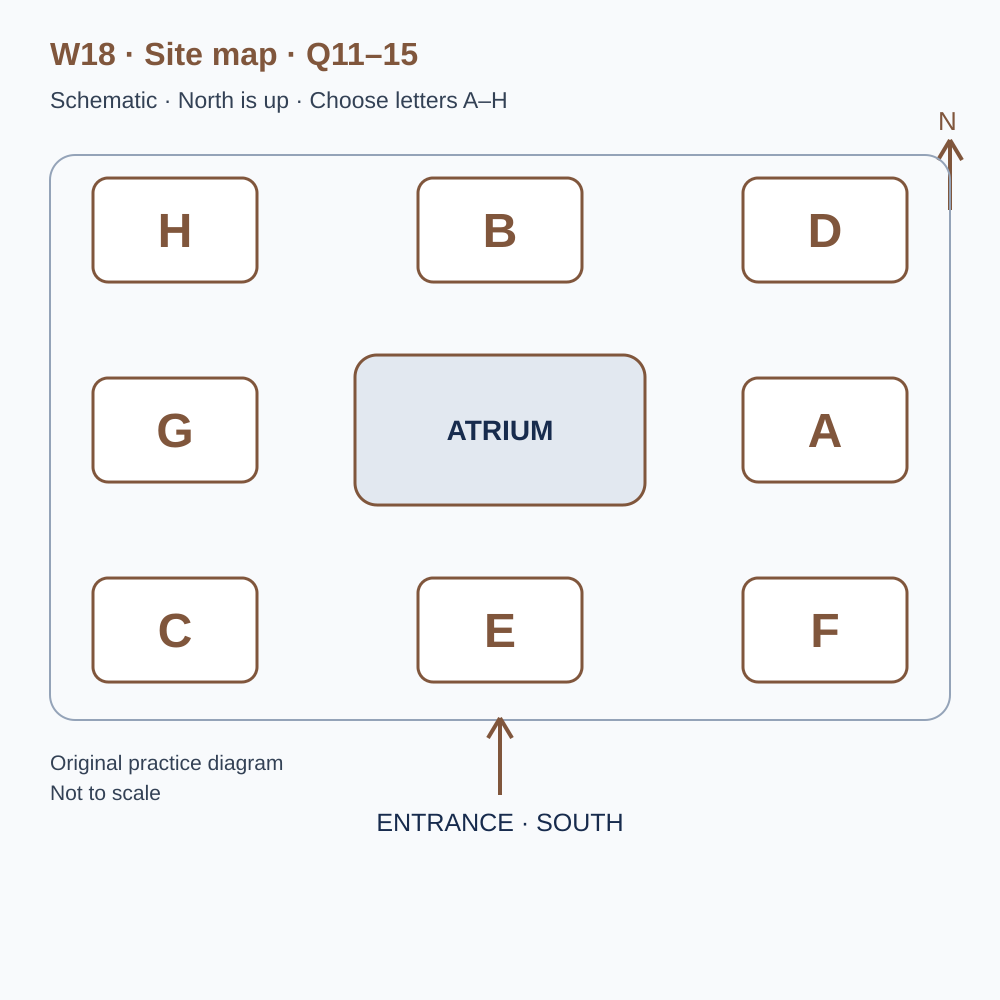
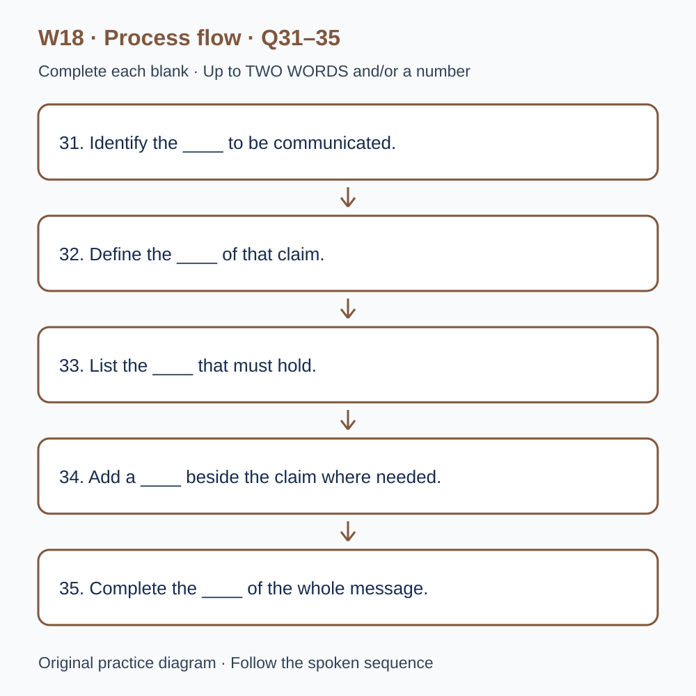

# L-W18 — Conditions, exceptions and the meaning of a claim

> 原创 IELTS-style 技能练习，非真题、非标准化模考，不可换算正式分数。当前只有文字和题目，音频未生成，不能计作已完成听力套题。

共四部分、40 个计分空，每空 1 分。正式首次作答须等待批准音频，先不要打开 script.md 或 answers.md。朗读前先看题；只听一遍后提交首次答案及信心等级，再做精听。当前只能预览题面，不能把读稿作答记作听力成绩。

## Part 1 — Booking a notice-writing workshop

Q1–6: Complete the notes. Write **NO MORE THAN TWO WORDS AND/OR A NUMBER** for each answer, using words from the recording. Numeric notation may replace spoken numbers. Do not repeat a printed unit. Q7–10: Choose **ONE letter, A, B or C**.

**Q1.** Workshop selected: ____

**Q2.** Confirmed day of July: ____

**Q3.** Teaching start (p.m.): ____

**Q4.** Number of places: ____

**Q5.** Total association fee: £____

**Q6.** Required current document: ____

**Q7.** What should the association expect?

- A. A guaranteed complete publication
- B. Practice in making and explaining revisions
- C. Legal wording for every real arrangement

Answer: ____

**Q8.** Which image use is appropriate?

- A. Any image received by email
- B. Workshop permission assumed to cover later publication
- C. Use within checked permissions, or a placeholder

Answer: ____

**Q9.** What should happen with a digital-format requirement?

- A. Describe it in advance for availability checks
- B. Assume larger print is equivalent
- C. Wait until the activity starts

Answer: ____

**Q10.** Which practical information should the group follow?

- A. Convenient details combined from old messages
- B. The current confirmation and updates quoting its reference
- C. Only the earliest programme

Answer: ____

## Part 2 — Orientation at the communication centre

Q11–15: Label the map. Write **ONE letter, A–H**, for each destination. Three letters are unused. Q16–20: Choose **ONE letter, A, B or C**.

**Q11.** Reception

Answer: ____

**Q12.** Interpretation room

Answer: ____

**Q13.** Example display

Answer: ____

**Q14.** Testing booth

Answer: ____

**Q15.** Resource desk

Answer: ____

**Q16.** What should guide the opening review?

- A. The amount of background available
- B. The decision the intended reader needs to make
- C. A universal rule for the shortest possible notice

Answer: ____

**Q17.** Why keep a condition near its claim?

- A. All sentences must be long
- B. Footnotes are always inaccurate
- C. Distance may change the apparent scope of the promise

Answer: ____

**Q18.** What should the team do with an uncertain practical detail?

- A. State its status and the route for an update
- B. Invent a precise figure
- C. Let layout imply that it is confirmed

Answer: ____

**Q19.** During reader testing, the team should

- A. supply its preferred explanation first
- B. record an action and ask a neutral follow-up
- C. treat every wrong selection as the same cause

Answer: ____

**Q20.** What should the closing review check?

- A. Only visual neatness
- B. Whether every background fact was included
- C. Requirements, qualifications and remaining uncertainty

Answer: ____

## Part 3 — Revising a visitor message

Q21–26: Match each proposal to the students' **final** positions at the end of that exchange. The tutor is not included. Write **A, B, C or D**. Letters may be reused.

- **A** Mae only
- **B** Jon only
- **C** Both students
- **D** Neither student

Q27–28 and Q29–30: Choose **TWO different letters, A–E**, for each pair. Write one letter in each numbered slot; either order is accepted. Each distinct correct choice earns one point, maximum two. Repeating a letter cannot earn two points. Submit no more than two letters.

**Q21.** At the END of this exchange, who supports: Retaining the eligibility condition beside the headline?

Answer: ____

**Q22.** At the END of this exchange, who supports: Putting the confirmed closing time in the opening panel?

Answer: ____

**Q23.** At the END of this exchange, who supports: Keeping the claim that the activity suits everyone?

Answer: ____

**Q24.** At the END of this exchange, who supports: Recruiting unfamiliar readers for the next test?

Answer: ____

**Q25.** At the END of this exchange, who supports: Preserving exact notice versions with test records?

Answer: ____

**Q26.** At the END of this exchange, who supports: Recording a short verbal explanation from each reader?

Answer: ____

**Q27–28.** Which TWO revision actions are agreed?

- A. Keep all historical background
- B. Give every panel equal length
- C. Retain conditions affecting the headline claim
- D. Insert a temporary invented number
- E. Separate confirmed facts from assumptions

Answers: Q27 ____ · Q28 ____

**Q29–30.** Which TWO factors limit the comparison of reader sessions?

- A. Both sessions were cancelled
- B. Reader groups differed in relevant experience
- C. Every printed page was incomplete
- D. The question asked after reading changed
- E. The room was unavailable

Answers: Q29 ____ · Q30 ____

## Part 4 — Keeping qualifications connected to claims

Q31–35: Complete the flow chart below. Q36–40: Complete the notes. Write **NO MORE THAN TWO WORDS AND/OR A NUMBER** for each answer, using words from the recording. Numeric notation may replace spoken numbers. Words or units already printed do not belong in the blank. The numbered text below repeats the SVG prompts for readability.

**Q31.** Identify the ____ to be communicated.

**Q32.** Define the ____ of that claim.

**Q33.** List the ____ that must hold.

**Q34.** Add a ____ beside the claim where needed.

**Q35.** Complete the ____ of the whole message.

**Q36.** More than one plausible reading indicates ____.

**Q37.** Consider the ____ readers draw from the layout.

**Q38.** A ____ can acknowledge a competing consideration.

**Q39.** Attention to a feature is affected by its ____.

**Q40.** Connecting claims with sources and revisions requires ____.

## 本周训练安排（音频批准后执行）

- Preview questions without the script：8 分钟。
- Future continuous first listen, including planned part pauses：32 分钟。
- Submit first answers and confidence, without a second play：8 分钟。
- Check answers and classify errors：20 分钟。
- Four Q-located intensive segments, 15 minutes each：60 分钟。
- Diagram and opinion retelling：15 分钟。
- Next-day retry of missed items：15 分钟。

合计 **158 分钟**；最多另用 22 分钟缓冲，总计不超过 180 分钟。暂停、回放与查词均计入精听预算，不能另行无限追加。当前实际已完成听力分钟数为 0。精听区段和步骤见 intensive.md；答案和脚本另页。
