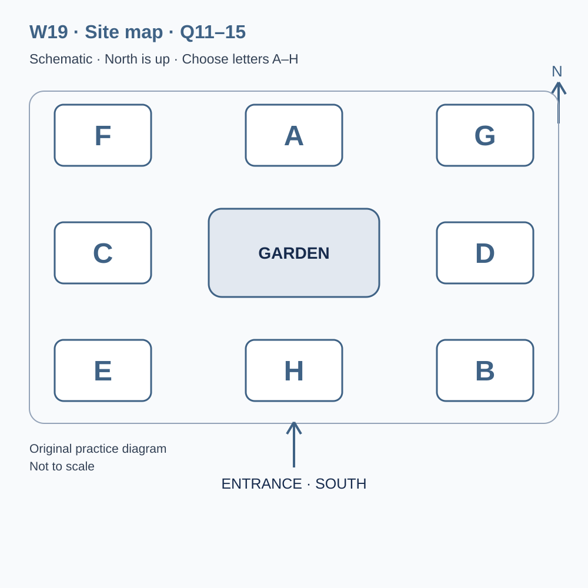
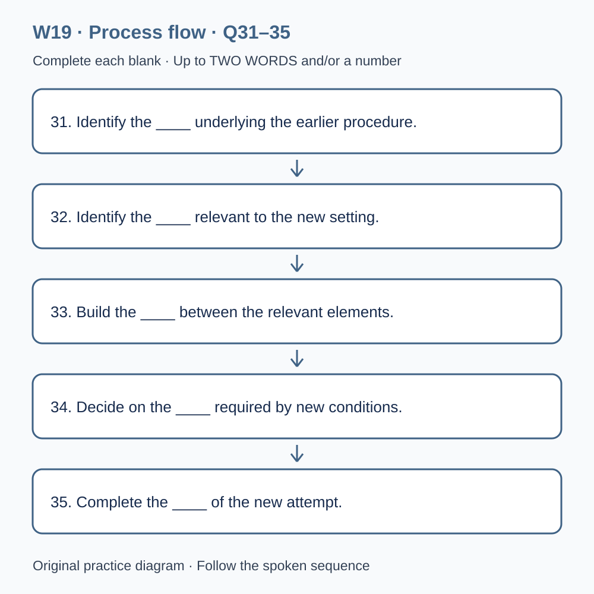

# L-W19 — Transferring a procedure to an unfamiliar setting

> 原创 IELTS-style 技能练习，非真题、非标准化模考，不可换算正式分数。当前只有文字和题目，音频未生成，不能计作已完成听力套题。

共四部分、40 个计分空，每空 1 分。正式首次作答须等待批准音频，先不要打开 script.md 或 answers.md。朗读前先看题；只听一遍后提交首次答案及信心等级，再做精听。当前只能预览题面，不能把读稿作答记作听力成绩。

## Part 1 — Booking a route-testing session

Q1–6: Complete the notes. Write **NO MORE THAN TWO WORDS AND/OR A NUMBER** for each answer, using words from the recording. Numeric notation may replace spoken numbers. Do not repeat a printed unit. Q7–10: Choose **ONE letter, A, B or C**.

**Q1.** Workshop topic: ____

**Q2.** Confirmed day of September: ____

**Q3.** Teaching start (a.m.): ____

**Q4.** Number of participants: ____

**Q5.** Total group fee: £____

**Q6.** Required planning document: ____

**Q7.** What can the session provide?

- A. A guarantee for every future visitor
- B. A testing method and a bounded interpretation of a trial
- C. Proof that all routes have equivalent demands

Answer: ____

**Q8.** If the outdoor practice area cannot be used, the group should

- A. choose an unconfirmed route
- B. report that the original trial occurred unchanged
- C. follow the approved update and record the actual activity

Answer: ____

**Q9.** How should a map-format requirement be addressed?

- A. Ask about the specific need before the session
- B. Assume a photograph is an equivalent file
- C. Conceal the arrangement in the trial record

Answer: ____

**Q10.** How should a withdrawal be reported?

- A. Through public comments only
- B. Through the confirmation reference
- C. By leaving the attendance list unchanged

Answer: ____

## Part 2 — Orientation at the visitor research centre

Q11–15: Label the map. Write **ONE letter, A–H**, for each destination. Three letters are unused. Q16–20: Choose **ONE letter, A, B or C**.

**Q11.** Reception

Answer: ____

**Q12.** Briefing room

Answer: ____

**Q13.** Map collection desk

Answer: ____

**Q14.** Observation room

Answer: ____

**Q15.** Return desk

Answer: ____

**Q16.** What should happen before using left or right?

- A. Assume everyone faces the same way
- B. Switch silently between viewpoints
- C. Establish and preserve the reference frame

Answer: ____

**Q17.** If the approved route is unavailable, participants should

- A. ask the leader about the stated alternative
- B. enter an unconfirmed area to finish the sheet
- C. claim the original route was tested

Answer: ____

**Q18.** How should an observer handle a pause?

- A. Automatically record it as failure
- B. Describe it before interpreting the cause
- C. Erase it if the destination is reached

Answer: ____

**Q19.** What should guide revision of the route material?

- A. The output required by the brief
- B. Decorative detail alone
- C. All available building history

Answer: ____

**Q20.** What belongs in the closing report?

- A. A future test presented as completed
- B. A universal guarantee from one arrival
- C. Actual actions, support and remaining uncertainty

Answer: ____

## Part 3 — Planning a second route trial

Q21–26: Match each proposal to the students' **final** positions at the end of that exchange. The tutor is not included. Write **A, B, C or D**. Letters may be reused.

- **A** Nia only
- **B** Sam only
- **C** Both students
- **D** Neither student

Q27–28 and Q29–30: Choose **TWO different letters, A–E**, for each pair. Write one letter in each numbered slot; either order is accepted. Each distinct correct choice earns one point, maximum two. Repeating a letter cannot earn two points. Submit no more than two letters.

**Q21.** At the END of this exchange, who supports: Using a different building for the very next trial?

Answer: ____

**Q22.** At the END of this exchange, who supports: Preserving the exact instruction wording for one more comparison?

Answer: ____

**Q23.** At the END of this exchange, who supports: Including a fixed reference landmark on every map?

Answer: ____

**Q24.** At the END of this exchange, who supports: Keeping left/right descriptions without a stated viewpoint?

Answer: ____

**Q25.** At the END of this exchange, who supports: Adding a diagram at the second decision point?

Answer: ____

**Q26.** At the END of this exchange, who supports: Limiting the report to the observed route and conditions?

Answer: ____

**Q27–28.** Which TWO preparation actions are agreed?

- A. Fix the starting position and orientation
- B. Collect all visitors' full names
- C. Record obstacles affecting the route
- D. Predict an official language score
- E. Remove pauses from the records

Answers: Q27 ____ · Q28 ____

**Q29–30.** Which TWO limitations affected last week's comparison?

- A. Both trials were cancelled
- B. The routes differed in complexity
- C. A map page was missing
- D. An observer gave a hint in one attempt
- E. No time records existed

Answers: Q29 ____ · Q30 ____

## Part 4 — Deciding what can carry across

Q31–35: Complete the flow chart below. Q36–40: Complete the notes. Write **NO MORE THAN TWO WORDS AND/OR A NUMBER** for each answer, using words from the recording. Numeric notation may replace spoken numbers. Words or units already printed do not belong in the blank. The numbered text below repeats the SVG prompts for readability.

**Q31.** Identify the ____ underlying the earlier procedure.

**Q32.** Identify the ____ relevant to the new setting.

**Q33.** Build the ____ between the relevant elements.

**Q34.** Decide on the ____ required by new conditions.

**Q35.** Complete the ____ of the new attempt.

**Q36.** Establish the ____ before evaluating a directional turn.

**Q37.** Additional processing demands contribute to ____.

**Q38.** Test the ____ between familiar and new settings.

**Q39.** Describe the ____ that restrict where a procedure is useful.

**Q40.** Plan ____ of the defined observation method.

## 本周训练安排（音频批准后执行）

- Preview questions without the script：8 分钟。
- Future continuous first listen, including planned part pauses：32 分钟。
- Submit first answers and confidence, without a second play：8 分钟。
- Check answers and classify errors：20 分钟。
- Four Q-located intensive segments, 15 minutes each：60 分钟。
- Diagram and opinion retelling：15 分钟。
- Next-day retry of missed items：15 分钟。

合计 **158 分钟**；最多另用 22 分钟缓冲，总计不超过 180 分钟。暂停、回放与查词均计入精听预算，不能另行无限追加。当前实际已完成听力分钟数为 0。精听区段和步骤见 intensive.md；答案和脚本另页。
