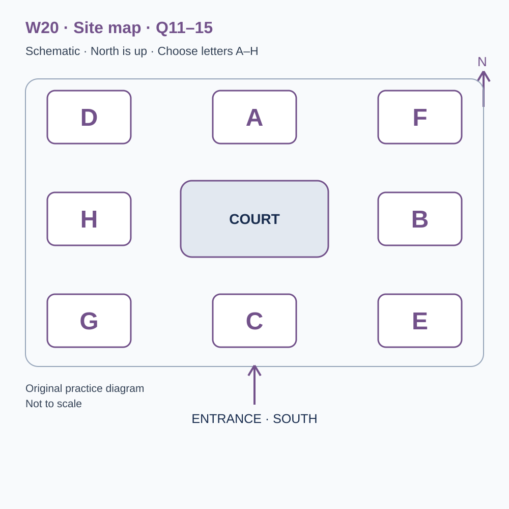
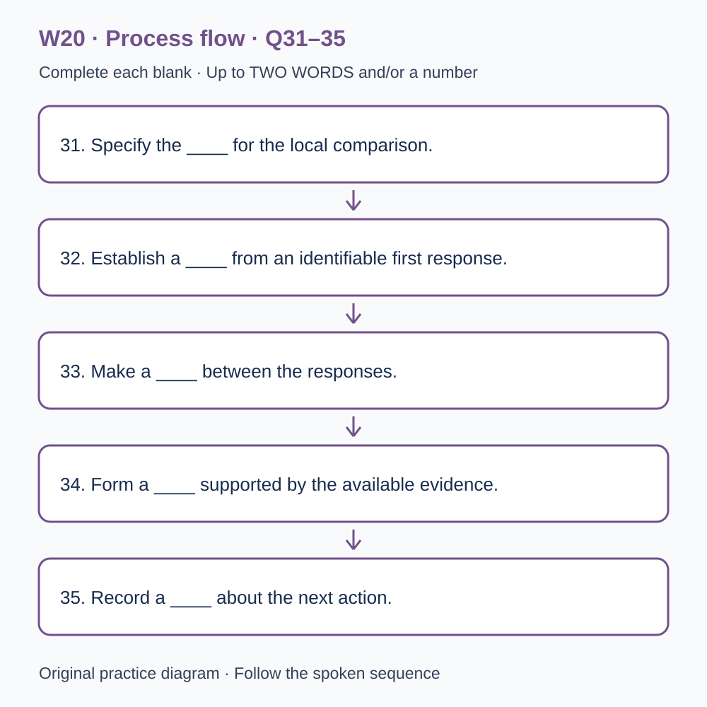

# L-W20 — An original checkpoint and a decision supported by evidence
> W20 是原创阶段检查，不能替代正式 T20，也不能据本练习换算官方分数。

> 原创 IELTS-style 技能练习，非真题、非标准化模考，不可换算正式分数。当前只有文字和题目，音频未生成，不能计作已完成听力套题。

共四部分、40 个计分空，每空 1 分。正式首次作答须等待批准音频，先不要打开 script.md 或 answers.md。朗读前先看题；只听一遍后提交首次答案及信心等级，再做精听。当前只能预览题面，不能把读稿作答记作听力成绩。

## Part 1 — Booking a checkpoint review

Q1–6: Complete the notes. Write **NO MORE THAN TWO WORDS AND/OR A NUMBER** for each answer, using words from the recording. Numeric notation may replace spoken numbers. Do not repeat a printed unit. Q7–10: Choose **ONE letter, A, B or C**.

**Q1.** Workshop selected: ____

**Q2.** Confirmed day of November: ____

**Q3.** Teaching start (p.m.): ____

**Q4.** Number of places: ____

**Q5.** Total booking cost: £____

**Q6.** Required collection of practice responses: ____

**Q7.** Can the local result replace a formal checkpoint?

- A. Yes, if the total is high
- B. No, formal requirements remain separate
- C. Only if a warning is added to an official band estimate

Answer: ____

**Q8.** How should a higher second total be interpreted?

- A. First compare task familiarity, timing and support
- B. As proven improvement without checking conditions
- C. As evidence that the first attempt was useless

Answer: ____

**Q9.** What should happen with a digital-format requirement?

- A. Assume standard print works
- B. Hide any access arrangement
- C. Describe the practical need before attendance

Answer: ____

**Q10.** How should a routine booking change be made?

- A. Through public comments alone
- B. By replying with the confirmation reference
- C. Through an unrelated old programme

Answer: ____

## Part 2 — Using the checkpoint facilities

Q11–15: Label the map. Write **ONE letter, A–H**, for each destination. Three letters are unused. Q16–20: Choose **ONE letter, A, B or C**.

**Q11.** Check-in

Answer: ____

**Q12.** Independent practice room

Answer: ____

**Q13.** Evidence room

Answer: ____

**Q14.** Decision room

Answer: ____

**Q15.** Resource collection point

Answer: ____

**Q16.** How should missing formal-assessment evidence be recorded?

- A. As proof of readiness
- B. As proof that study must be extended
- C. As unknown, with appropriate evidence still to obtain

Answer: ____

**Q17.** Before starting, participants should identify

- A. required outputs and what the stated limit includes
- B. the maximum possible amount of extra material
- C. an easier alternative task to assume

Answer: ____

**Q18.** Why save first and revised responses separately?

- A. To make help irrelevant
- B. They provide different evidence about performance and learning
- C. To prove every revision was unaided

Answer: ____

**Q19.** What should support a judgement about a claim?

- A. Its evidence and relevant limitations
- B. Confidence without reasons
- C. A permanent label inferred from one mistake

Answer: ____

**Q20.** What should the closing plan do?

- A. Require every learner to extend study
- B. Announce readiness from any improved total
- C. Choose a manageable action justified by actual evidence

Answer: ____

## Part 3 — Interpreting two practice attempts

Q21–26: Match each proposal to the students' **final** positions at the end of that exchange. The tutor is not included. Write **A, B, C or D**. Letters may be reused.

- **A** Lena only
- **B** Amir only
- **C** Both students
- **D** Neither student

Q27–28 and Q29–30: Choose **TWO different letters, A–E**, for each pair. Write one letter in each numbered slot; either order is accepted. Each distinct correct choice earns one point, maximum two. Repeating a letter cannot earn two points. Submit no more than two letters.

**Q21.** At the END of this exchange, who supports: Beginning the review with required-output coverage?

Answer: ____

**Q22.** At the END of this exchange, who supports: Adding an unfamiliar item as the very next action?

Answer: ____

**Q23.** At the END of this exchange, who supports: Converting the local total into an official band?

Answer: ____

**Q24.** At the END of this exchange, who supports: Interviewing the writer next about the omitted qualification?

Answer: ____

**Q25.** At the END of this exchange, who supports: Recording support alongside both attempts?

Answer: ____

**Q26.** At the END of this exchange, who supports: Setting the next review date before leaving today?

Answer: ____

**Q27–28.** Which TWO local indicators are agreed?

- A. Required-output coverage
- B. Handwriting rank
- C. Confidence alone
- D. Evidence traceability
- E. Official score forecast

Answers: Q27 ____ · Q28 ____

**Q29–30.** Which TWO limitations affected the completed comparison?

- A. The sessions were cancelled
- B. The second task was more familiar
- C. Response pages were missing
- D. No timing records existed
- E. Guidance differed between attempts

Answers: Q29 ____ · Q30 ____

## Part 4 — Making a qualified learning decision

Q31–35: Complete the flow chart below. Q36–40: Complete the notes. Write **NO MORE THAN TWO WORDS AND/OR A NUMBER** for each answer, using words from the recording. Numeric notation may replace spoken numbers. Words or units already printed do not belong in the blank. The numbered text below repeats the SVG prompts for readability.

**Q31.** Specify the ____ for the local comparison.

**Q32.** Establish a ____ from an identifiable first response.

**Q33.** Make a ____ between the responses.

**Q34.** Form a ____ supported by the available evidence.

**Q35.** Record a ____ about the next action.

**Q36.** Work produced without the help being investigated concerns ____.

**Q37.** A relevant pattern across suitable observations concerns ____.

**Q38.** Identify the source of ____ in the conclusion.

**Q39.** ____ for formal assessment cannot be established by this local exercise alone.

**Q40.** Set a ____ for examining the next evidence.

## 本周训练安排（音频批准后执行）

- Preview questions without the script：8 分钟。
- Future continuous first listen, including planned part pauses：32 分钟。
- Submit first answers and confidence, without a second play：8 分钟。
- Check answers and classify errors：20 分钟。
- Four Q-located intensive segments, 15 minutes each：60 分钟。
- Diagram and opinion retelling：15 分钟。
- Next-day retry of missed items：15 分钟。

合计 **158 分钟**；最多另用 22 分钟缓冲，总计不超过 180 分钟。暂停、回放与查词均计入精听预算，不能另行无限追加。当前实际已完成听力分钟数为 0。精听区段和步骤见 intensive.md；答案和脚本另页。
