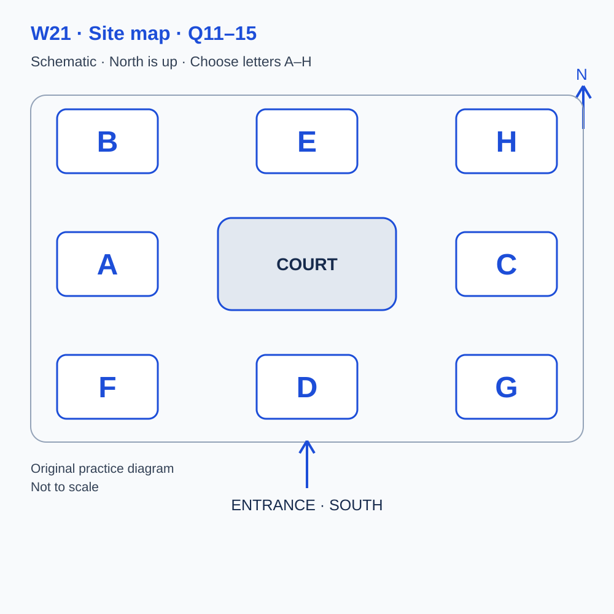
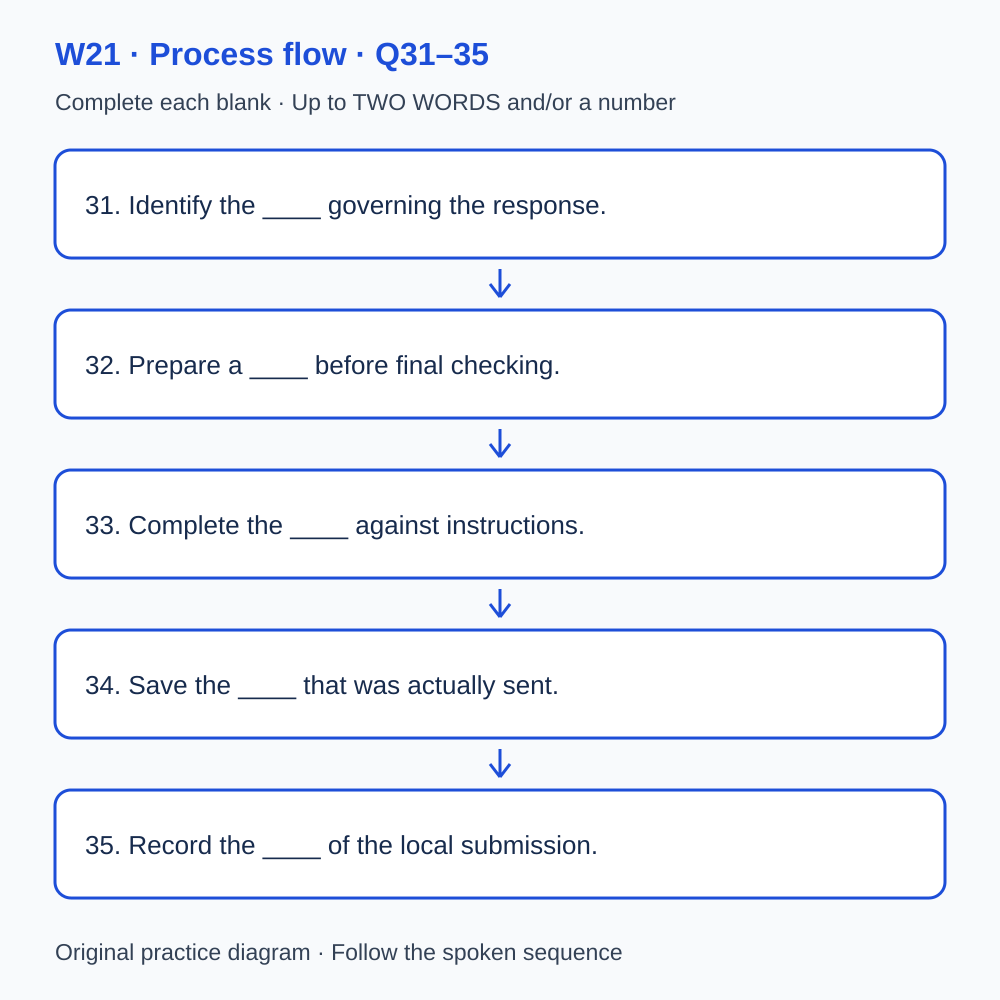

# L-W21 — Checking a response and recording what actually happened

> 原创 IELTS-style 技能练习，非真题、非标准化模考，不可换算正式分数。当前只有文字和题目，音频未生成，不能计作已完成听力套题。

共四部分、40 个计分空，每空 1 分。正式首次作答须等待批准音频，先不要打开 script.md 或 answers.md。朗读前先看题；只听一遍后提交首次答案及信心等级，再做精听。当前只能预览题面，不能把读稿作答记作听力成绩。

## Part 1 — Booking an interface practice workshop

Q1–6: Complete the notes. Write **NO MORE THAN TWO WORDS AND/OR A NUMBER** for each answer, using words from the recording. Numeric notation may replace spoken numbers. Do not repeat a printed unit. Q7–10: Choose **ONE letter, A, B or C**.

**Q1.** Selected workshop: ____

**Q2.** Confirmed date: ____ April

**Q3.** Workshop starts at ____ a.m.

**Q4.** Number attending: ____

**Q5.** Total booking cost: £____

**Q6.** Bring this required document: ____

**Q7.** What does the local workshop provide?

- A. Verified operation of a real examination platform
- B. An official assessment result
- C. Practice with a fictional local interface

Answer: ____

**Q8.** What should a participant do if they only observe?

- A. Record independent completion
- B. Obtain agreement and record observation
- C. Assume the leader will enter a result

Answer: ____

**Q9.** How should a format need be handled?

- A. Request it in advance and record the arrangement
- B. Assume a photograph provides equivalent access
- C. Wait until the outcome has been judged

Answer: ____

**Q10.** How should the booking be changed?

- A. Post a public comment
- B. Create an unsupported completion record
- C. Use the confirmation reference

Answer: ____

## Part 2 — Finding the practice facilities

Q11–15: Label the map. Write **ONE letter, A–H**, for each destination. Three letters are unused. Q16–20: Choose **ONE letter, A, B or C**.

**Q11.** Check-in

Answer: ____

**Q12.** Demonstration

Answer: ____

**Q13.** Individual practice

Answer: ____

**Q14.** Review

Answer: ____

**Q15.** Resources

Answer: ____

**Q16.** What distinction matters when checking an entry?

- A. Typing speed proves correctness
- B. Content requirements differ from entry mechanics
- C. A smooth action proves receipt

Answer: ____

**Q17.** What should happen after an item is skipped?

- A. Assume another platform has the same controls
- B. Fill it with an invented answer
- C. Preserve its position and verify the relevant controls

Answer: ____

**Q18.** What should be inspected after an edit?

- A. The resulting entry and its recorded state
- B. Only the answer intended
- C. Only the latest filename

Answer: ____

**Q19.** What should a participant do after unexpected behaviour?

- A. Repeat actions until a success is assumed
- B. Mark submission successful immediately
- C. Stop, record the event and ask the leader

Answer: ____

**Q20.** What should the final record distinguish?

- A. Only the intended activities
- B. The activities actually performed
- C. Local practice as proof of real-system operation

Answer: ____

## Part 3 — Comparing two local practice arrangements

Q21–26: Match each proposal to the students' **final** positions at the end of that exchange. The tutor is not included. Write **A, B, C or D**. Letters may be reused.

- **A** Rosa only
- **B** Ken only
- **C** Both students
- **D** Neither student

Q27–28 and Q29–30: Choose **TWO different letters, A–E**, for each pair. Write one letter in each numbered slot; either order is accepted. Each distinct correct choice earns one point, maximum two. Repeating a letter cannot earn two points. Submit no more than two letters.

**Q21.** At the END of this exchange, who supports: trying keyboard entry next?

Answer: ____

**Q22.** At the END of this exchange, who supports: preserving the version actually submitted?

Answer: ____

**Q23.** At the END of this exchange, who supports: using a spoken requirement check next?

Answer: ____

**Q24.** At the END of this exchange, who supports: marking real-interface operation complete from local work?

Answer: ____

**Q25.** At the END of this exchange, who supports: recording actual actions rather than intentions?

Answer: ____

**Q26.** At the END of this exchange, who supports: trying a second layout next?

Answer: ____

**Q27–28.** Which TWO actions are agreed for the local procedure?

- A. Replace the first response with corrections
- B. Check the required output
- C. Infer completion from a filename
- D. Discard submission evidence
- E. Record the submission state

Answers: Q27 ____ · Q28 ____

**Q29–30.** Which TWO differences limit comparison of the local trials?

- A. Prior familiarity with the question
- B. Different membership fees
- C. Unequal hints from an observer
- D. A missing room map
- E. A cancelled booking

Answers: Q29 ____ · Q30 ____

## Part 4 — From a requirement to a recorded submission

Q31–35: Complete the flow chart below. Q36–40: Complete the notes. Write **NO MORE THAN TWO WORDS AND/OR A NUMBER** for each answer, using words from the recording. Numeric notation may replace spoken numbers. Words or units already printed do not belong in the blank. The numbered text below repeats the SVG prompts for readability.

**Q31.** Identify the ____ governing the response.

**Q32.** Prepare a ____ before final checking.

**Q33.** Complete the ____ against instructions.

**Q34.** Save the ____ that was actually sent.

**Q35.** Record the ____ of the local submission.

**Q36.** Named practice for keeping versions in sequence: ____

**Q37.** Preserve the ____ needed to resume the task.

**Q38.** Named term for a signal of system response: ____

**Q39.** Named term for an unintended change to another entry: ____

**Q40.** Named property allowing inspection of a record’s basis: ____

## 本周训练安排（音频批准后执行）

- Preview questions without the script：8 分钟。
- Future continuous first listen, including planned part pauses：32 分钟。
- Submit first answers and confidence, without a second play：8 分钟。
- Check answers and classify errors：20 分钟。
- Four Q-located intensive segments, 15 minutes each：60 分钟。
- Diagram and opinion retelling：15 分钟。
- Next-day retry of missed items：15 分钟。

合计 **158 分钟**；最多另用 22 分钟缓冲，总计不超过 180 分钟。暂停、回放与查词均计入精听预算，不能另行无限追加。当前实际已完成听力分钟数为 0。精听区段和步骤见 intensive.md；答案和脚本另页。

## 活动与实际操作分开记录

本地题面核对、观察演示、本地输入和真实考试界面操作是不同活动。当前真实界面未操作、平台/日期/证据均未知，不得勾选完成。记录字段：活动类型／实际操作日期／平台或材料／观察结果／证据引用／未核验项。将原15分钟复述中的最后3分钟用于填写已有事实，替换该部分口述，不另加训练。无事实时保留空白或未知。
