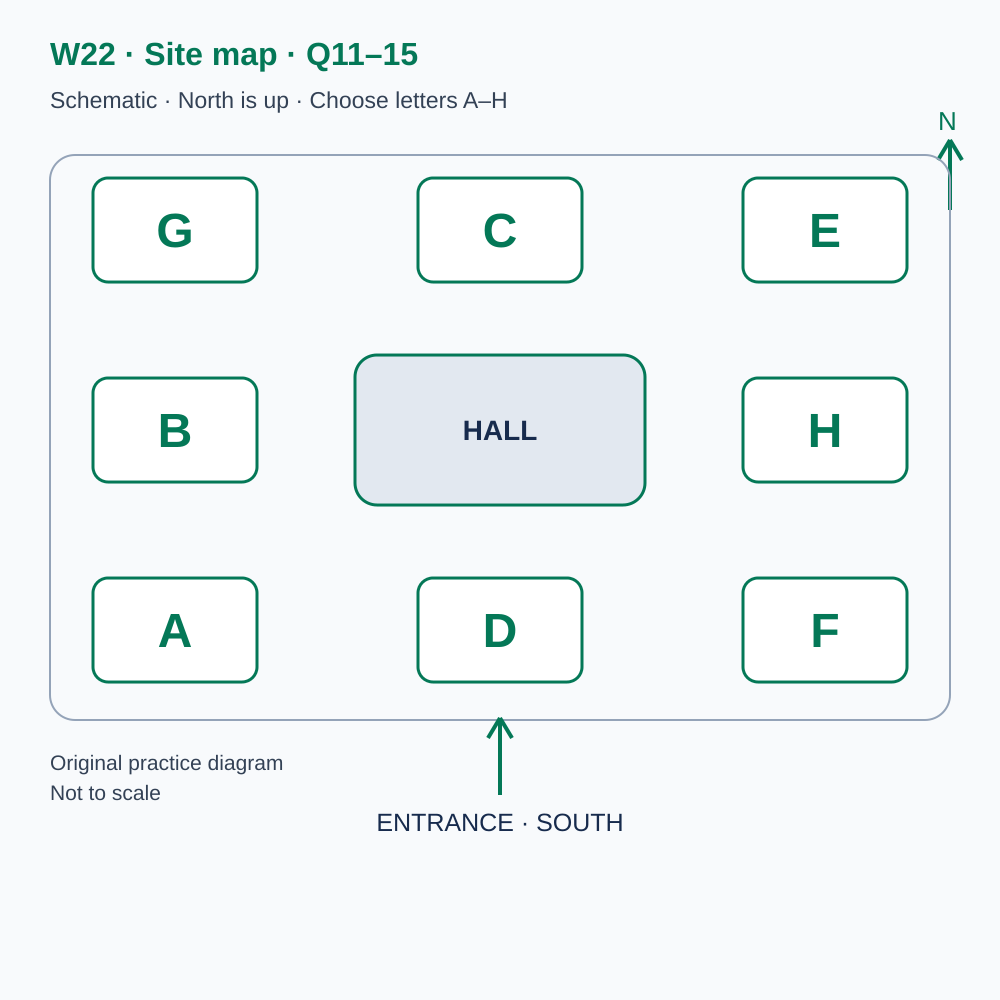
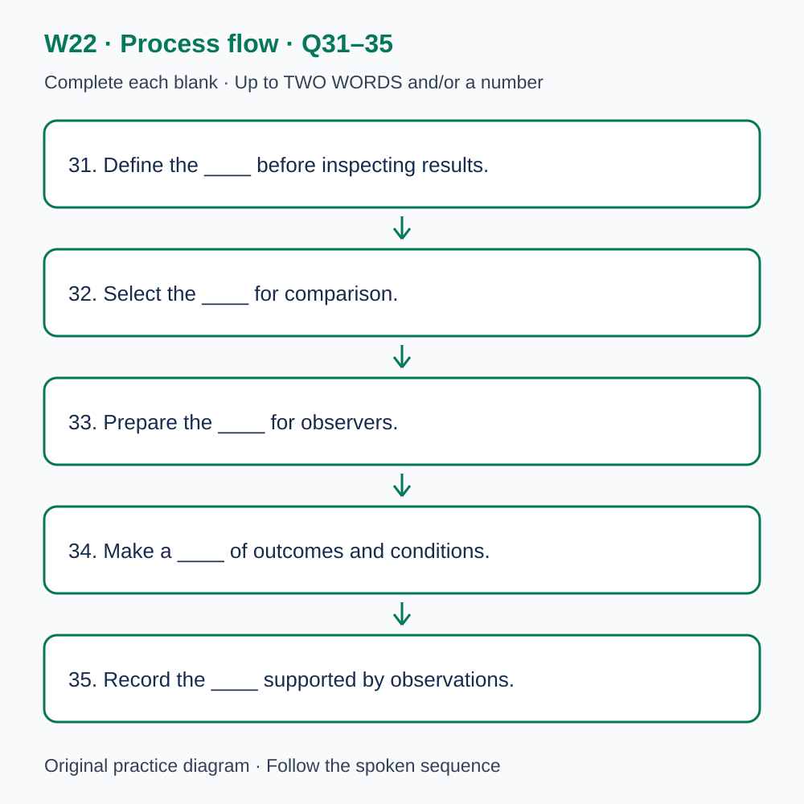

# L-W22 — An original checkpoint in comparing evidence
> W22 是原创阶段检查，不能替代正式 T22，也不能据本练习换算官方分数。

> 原创 IELTS-style 技能练习，非真题、非标准化模考，不可换算正式分数。当前只有文字和题目，音频未生成，不能计作已完成听力套题。

共四部分、40 个计分空，每空 1 分。正式首次作答须等待批准音频，先不要打开 script.md 或 answers.md。朗读前先看题；只听一遍后提交首次答案及信心等级，再做精听。当前只能预览题面，不能把读稿作答记作听力成绩。

## Part 1 — Booking a comparison workshop

Q1–6: Complete the notes. Write **NO MORE THAN TWO WORDS AND/OR A NUMBER** for each answer, using words from the recording. Numeric notation may replace spoken numbers. Do not repeat a printed unit. Q7–10: Choose **ONE letter, A, B or C**.

**Q1.** Selected workshop: ____

**Q2.** Confirmed date: ____ June

**Q3.** Workshop starts at ____ a.m.

**Q4.** Number attending: ____

**Q5.** Total booking cost: £____

**Q6.** Bring this essential document: ____

**Q7.** How should the original workshop result be treated?

- A. As an official examination result
- B. As local evidence separate from formal assessment
- C. As an automatic replacement for T22

Answer: ____

**Q8.** How should trial records be prepared?

- A. Invent missing figures
- B. Keep all identifiers regardless of purpose
- C. Use relevant permission and remove unnecessary identifiers

Answer: ____

**Q9.** What should a participant with a format need do?

- A. Request arrangements in advance
- B. Assume all formats are equivalent
- C. Omit the arrangement from the record

Answer: ____

**Q10.** How should a booking change be requested?

- A. Through a public discussion
- B. By replying with the confirmation reference
- C. By editing a trial result

Answer: ____

## Part 2 — Orientation at the research centre

Q11–15: Label the map. Write **ONE letter, A–H**, for each destination. Three letters are unused. Q16–20: Choose **ONE letter, A, B or C**.

**Q11.** Reception

Answer: ____

**Q12.** Briefing

Answer: ____

**Q13.** Example display

Answer: ____

**Q14.** Observation

Answer: ____

**Q15.** Resources

Answer: ____

**Q16.** What must a checkpoint response contain?

- A. Only the most favourable total
- B. A finding and a relevant limitation
- C. An official band conversion

Answer: ____

**Q17.** What should be checked before comparing totals?

- A. Whether the preferred explanation is attractive
- B. Whether the totals look similar
- C. The definitions used in each session

Answer: ____

**Q18.** How should missing data be handled?

- A. Keep it missing and separate any assumptions
- B. Enter zero automatically
- C. Copy a plausible neighbouring value

Answer: ____

**Q19.** How should competing explanations be examined?

- A. Select the most familiar explanation
- B. Identify evidence that could distinguish them
- C. Treat a planned test as completed

Answer: ____

**Q20.** How should first responses and revisions be recorded?

- A. Convert the revised local total into a formal score
- B. Replace the first response after correction
- C. Keep them separate, with local counts correctly labelled

Answer: ____

## Part 3 — Reviewing a visitor-layout trial

Q21–26: Match each proposal to the students' **final** positions at the end of that exchange. The tutor is not included. Write **A, B, C or D**. Letters may be reused.

- **A** Tess only
- **B** Noah only
- **C** Both students
- **D** Neither student

Q27–28 and Q29–30: Choose **TWO different letters, A–E**, for each pair. Write one letter in each numbered slot; either order is accepted. Each distinct correct choice earns one point, maximum two. Repeating a letter cannot earn two points. Submit no more than two letters.

**Q21.** At the END of this exchange, who supports: retaining the fixed outcome definition?

Answer: ____

**Q22.** At the END of this exchange, who supports: adding a comparison area next?

Answer: ____

**Q23.** At the END of this exchange, who supports: interviewing visitors next?

Answer: ____

**Q24.** At the END of this exchange, who supports: claiming that the layout caused every improvement?

Answer: ____

**Q25.** At the END of this exchange, who supports: leaving missing observations missing?

Answer: ____

**Q26.** At the END of this exchange, who supports: observing a busy period next?

Answer: ____

**Q27–28.** Which TWO actions are agreed for the next record?

- A. Preserve the outcome definition
- B. Treat missing data as zero
- C. Delete unexpected observations
- D. Record relevant conditions
- E. Claim a general causal effect

Answers: Q27 ____ · Q28 ____

**Q29–30.** Which TWO differences limit the session comparison?

- A. A cancelled session
- B. Visitors’ prior experience
- C. Lost records from both sessions
- D. Different admission fees
- E. Weekday versus weekend conditions

Answers: Q29 ____ · Q30 ____

## Part 4 — Interpreting a small comparison responsibly

Q31–35: Complete the flow chart below. Q36–40: Complete the notes. Write **NO MORE THAN TWO WORDS AND/OR A NUMBER** for each answer, using words from the recording. Numeric notation may replace spoken numbers. Words or units already printed do not belong in the blank. The numbered text below repeats the SVG prompts for readability.

**Q31.** Define the ____ before inspecting results.

**Q32.** Select the ____ for comparison.

**Q33.** Prepare the ____ for observers.

**Q34.** Make a ____ of outcomes and conditions.

**Q35.** Record the ____ supported by observations.

**Q36.** Named process in which people choose whether to participate: ____

**Q37.** Named process of assigning values by a stated rule: ____

**Q38.** Named term for the competing influence linked to exposure and outcome: ____

**Q39.** Named term for what would have happened without the change: ____

**Q40.** State the ____ on the causal claim.

## 本周训练安排（音频批准后执行）

- Preview questions without the script：8 分钟。
- Future continuous first listen, including planned part pauses：32 分钟。
- Submit first answers and confidence, without a second play：8 分钟。
- Check answers and classify errors：20 分钟。
- Four Q-located intensive segments, 15 minutes each：60 分钟。
- Diagram and opinion retelling：15 分钟。
- Next-day retry of missed items：15 分钟。

合计 **158 分钟**；最多另用 22 分钟缓冲，总计不超过 180 分钟。暂停、回放与查词均计入精听预算，不能另行无限追加。当前实际已完成听力分钟数为 0。精听区段和步骤见 intensive.md；答案和脚本另页。
