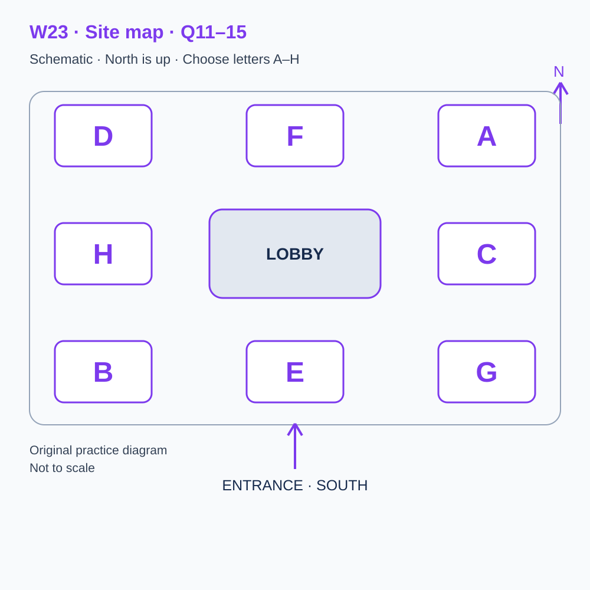
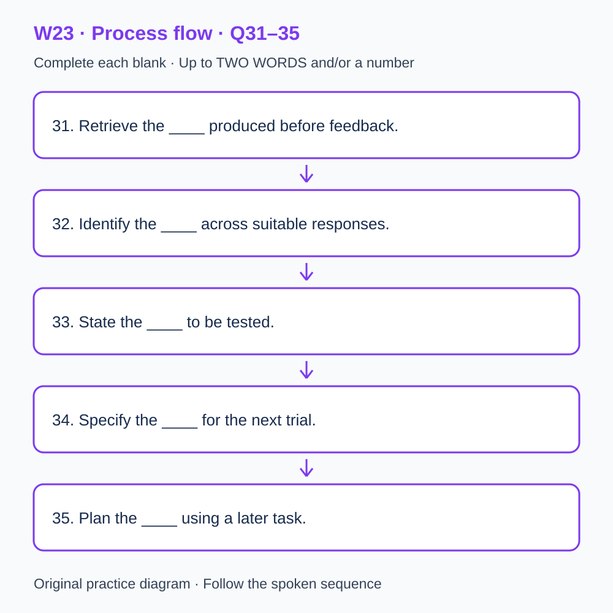

# L-W23 — Choosing targeted practice from genuine response evidence

> 原创 IELTS-style 技能练习，非真题、非标准化模考，不可换算正式分数。当前只有文字和题目，音频未生成，不能计作已完成听力套题。

共四部分、40 个计分空，每空 1 分。正式首次作答须等待批准音频，先不要打开 script.md 或 answers.md。朗读前先看题；只听一遍后提交首次答案及信心等级，再做精听。当前只能预览题面，不能把读稿作答记作听力成绩。

## Part 1 — Booking a targeted-practice session

Q1–6: Complete the notes. Write **NO MORE THAN TWO WORDS AND/OR A NUMBER** for each answer, using words from the recording. Numeric notation may replace spoken numbers. Do not repeat a printed unit. Q7–10: Choose **ONE letter, A, B or C**.

**Q1.** Selected session: ____

**Q2.** Confirmed date: ____ August

**Q3.** Session starts at ____ p.m.

**Q4.** Number attending: ____

**Q5.** Total booking cost: £____

**Q6.** If available, bring the ____ produced before feedback.

**Q7.** What is needed to identify a useful practice focus?

- A. A diagnosis inferred from the total alone
- B. The learner’s genuine responses and conditions
- C. A weakness copied from a fictional example

Answer: ____

**Q8.** How should later clarification of a note be recorded?

- A. Replace the original note
- B. Treat lost track as a settled diagnosis
- C. Keep it separate from the original observation

Answer: ____

**Q9.** How should format support be handled?

- A. Arrange it in advance and distinguish actual support
- B. Assume supported and independent attempts are equivalent
- C. Hide the support from the record

Answer: ____

**Q10.** How should a change to the booking be made?

- A. Invent evidence to complete the folder
- B. Use its confirmation reference
- C. Submit a corrected answer as the booking record

Answer: ____

## Part 2 — Orientation at the review centre

Q11–15: Label the map. Write **ONE letter, A–H**, for each destination. Three letters are unused. Q16–20: Choose **ONE letter, A, B or C**.

**Q11.** Check-in

Answer: ____

**Q12.** Records

Answer: ____

**Q13.** Trial design

Answer: ____

**Q14.** Consultation

Answer: ____

**Q15.** Resources

Answer: ____

**Q16.** What is the starting point for personal remediation?

- A. An assumed common weakness
- B. A diagnosis from reading a fictional transcript
- C. A genuine first response, or an unknown status if absent

Answer: ____

**Q17.** What distinction should the error review preserve?

- A. Observed pattern versus proposed cause
- B. Correctness versus room location
- C. A total versus the booking fee

Answer: ____

**Q18.** How should a targeted activity fit the timetable?

- A. Add unlimited practice
- B. Replace work within the existing budget
- C. Omit time spent replaying

Answer: ____

**Q19.** How should improvement be interpreted?

- A. Retain relevant task and support conditions
- B. Ignore differences in guidance
- C. Attribute it all to the new routine

Answer: ____

**Q20.** How should a later check be recorded?

- A. Invent a cause if the result is mixed
- B. Treat a corrected familiar item as unseen
- C. Distinguish fresh evidence from familiar-item practice

Answer: ____

## Part 3 — Selecting a small repair trial

Q21–26: Match each proposal to the students' **final** positions at the end of that exchange. The tutor is not included. Write **A, B, C or D**. Letters may be reused.

- **A** Mila only
- **B** Evan only
- **C** Both students
- **D** Neither student

Q27–28 and Q29–30: Choose **TWO different letters, A–E**, for each pair. Write one letter in each numbered slot; either order is accepted. Each distinct correct choice earns one point, maximum two. Repeating a letter cannot earn two points. Submit no more than two letters.

**Q21.** At the END of this exchange, who supports: starting with the observed word-limit pattern?

Answer: ____

**Q22.** At the END of this exchange, who supports: preserving the original response?

Answer: ____

**Q23.** At the END of this exchange, who supports: asking for a brief neutral explanation before feedback?

Answer: ____

**Q24.** At the END of this exchange, who supports: calling every omission a memory problem?

Answer: ____

**Q25.** At the END of this exchange, who supports: using an unfamiliar item next?

Answer: ____

**Q26.** At the END of this exchange, who supports: retaining two plausible explanations?

Answer: ____

**Q27–28.** Which TWO actions are agreed for the small repair trial?

- A. Diagnose every omission alike
- B. Choose a pattern supported by evidence
- C. Add several unrelated procedures
- D. Change one manageable procedure
- E. Replace original answers with corrections

Answers: Q27 ____ · Q28 ____

**Q29–30.** Which TWO limitations remain in the records?

- A. Some first responses are missing
- B. No records exist at all
- C. Every task was cancelled
- D. All learners received identical guidance
- E. Guidance was unequal

Answers: Q29 ____ · Q30 ____

## Part 4 — Testing a proposed explanation for an error pattern

Q31–35: Complete the flow chart below. Q36–40: Complete the notes. Write **NO MORE THAN TWO WORDS AND/OR A NUMBER** for each answer, using words from the recording. Numeric notation may replace spoken numbers. Words or units already printed do not belong in the blank. The numbered text below repeats the SVG prompts for readability.

**Q31.** Retrieve the ____ produced before feedback.

**Q32.** Identify the ____ across suitable responses.

**Q33.** State the ____ to be tested.

**Q34.** Specify the ____ for the next trial.

**Q35.** Plan the ____ using a later task.

**Q36.** Named term for the alternative given up when time is allocated: ____

**Q37.** Named term for arranging the order of activities: ____

**Q38.** Named term for a conclusion extending beyond its evidence: ____

**Q39.** Named term for applying learning when the task changes: ____

**Q40.** Exact status word when personal evidence is absent: ____

## 本周训练安排（音频批准后执行）

- Preview questions without the script：8 分钟。
- Future continuous first listen, including planned part pauses：32 分钟。
- Submit first answers and confidence, without a second play：8 分钟。
- Check answers and classify errors：20 分钟。
- Four Q-located intensive segments, 15 minutes each：60 分钟。
- Diagram and opinion retelling：15 分钟。
- Next-day retry of missed items：15 分钟。

合计 **158 分钟**；最多另用 22 分钟缓冲，总计不超过 180 分钟。暂停、回放与查词均计入精听预算，不能另行无限追加。当前实际已完成听力分钟数为 0。精听区段和步骤见 intensive.md；答案和脚本另页。

## 补弱选择以真实错题为依据

当前没有本套音频或个人首答，不能指定你的弱项。已有可核验首答时，记录题号、原答、原文证据和当时条件，再选择一个反复出现且有证据的模式。没有首答或条件不明时记未知；仅学习审阅方法，待批准音频后采集新首答，不虚构错题。补弱时间使用既有60分钟精听预算，不额外叠加。
