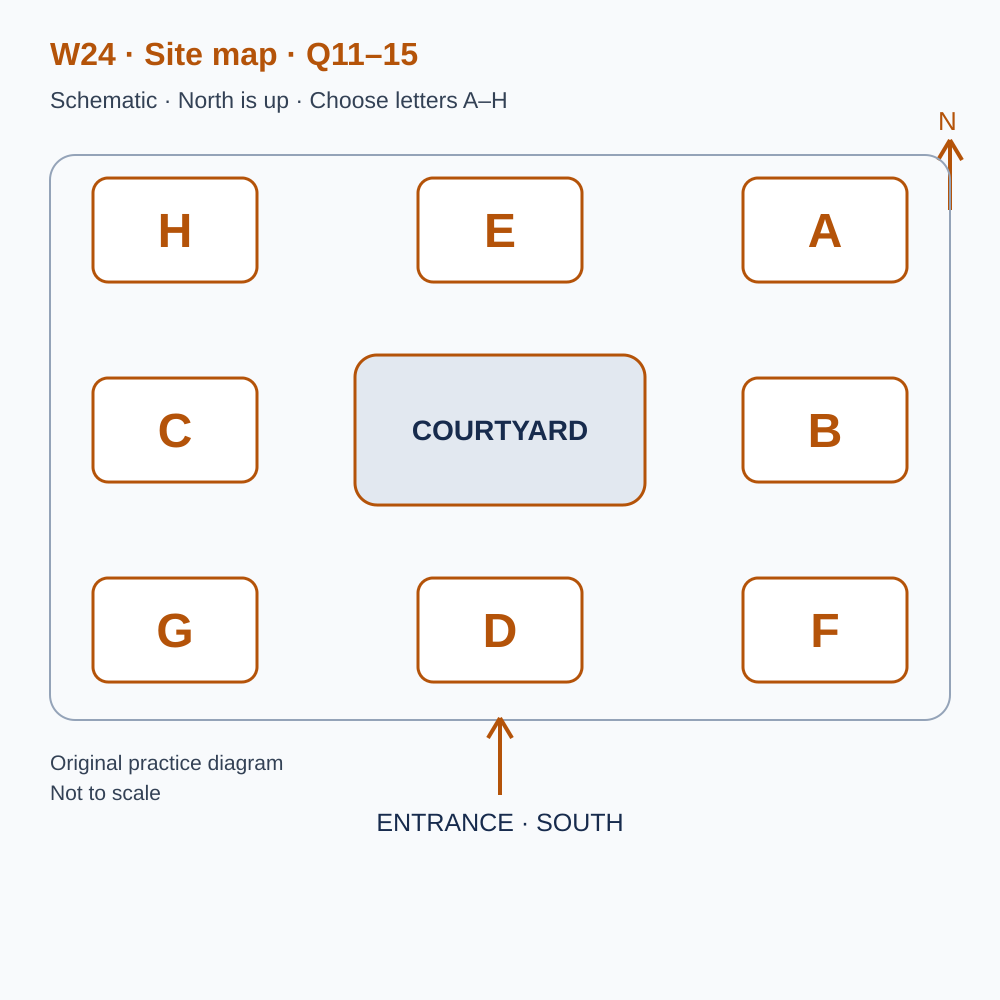
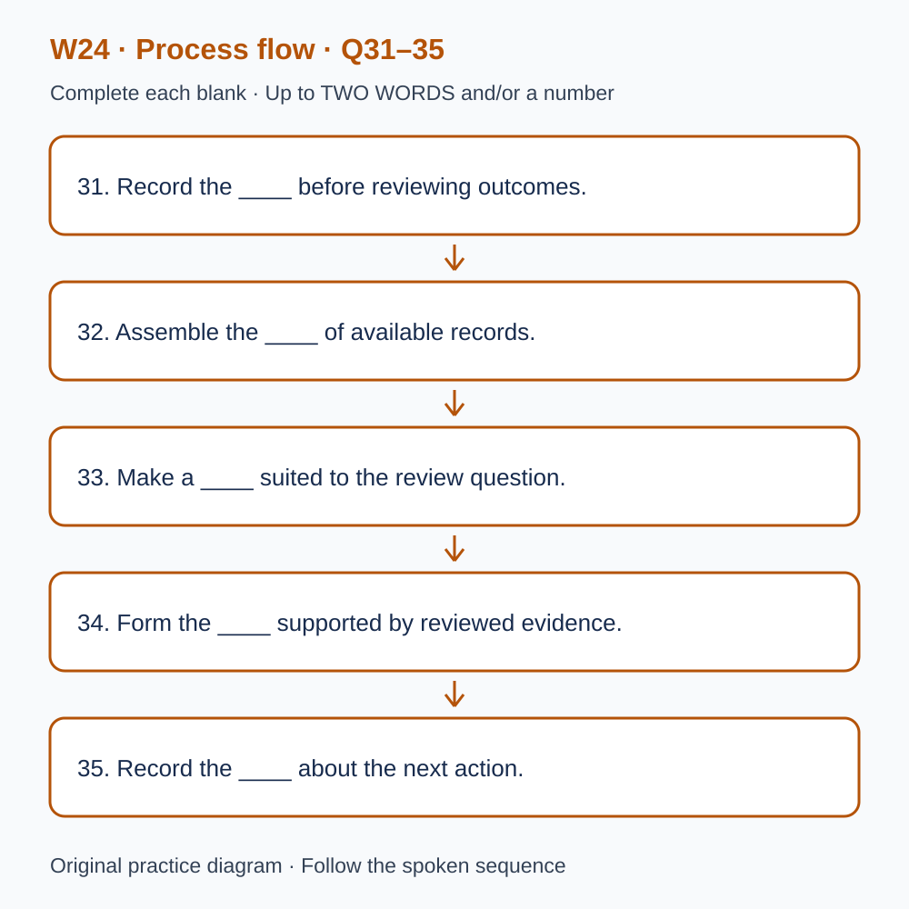

# L-W24 — Keeping different kinds of progress evidence separate
> W24 是原创阶段检查，不能替代正式 T24，也不能据本练习换算官方分数。

> 原创 IELTS-style 技能练习，非真题、非标准化模考，不可换算正式分数。当前只有文字和题目，音频未生成，不能计作已完成听力套题。

共四部分、40 个计分空，每空 1 分。正式首次作答须等待批准音频，先不要打开 script.md 或 answers.md。朗读前先看题；只听一遍后提交首次答案及信心等级，再做精听。当前只能预览题面，不能把读稿作答记作听力成绩。

## Part 1 — Booking a progress review workshop

Q1–6: Complete the notes. Write **NO MORE THAN TWO WORDS AND/OR A NUMBER** for each answer, using words from the recording. Numeric notation may replace spoken numbers. Do not repeat a printed unit. Q7–10: Choose **ONE letter, A, B or C**.

**Q1.** Selected workshop: ____

**Q2.** Confirmed date: ____ November

**Q3.** Workshop starts at ____ p.m.

**Q4.** Number attending: ____

**Q5.** Total booking cost: £____

**Q6.** Bring the ____ of available records.

**Q7.** What is the status of this original exercise?

- A. It replaces the formal checkpoint
- B. It is local practice with a separate result
- C. It provides an official band conversion

Answer: ____

**Q8.** What should happen when a target is not supplied?

- A. Leave it unknown until clarified
- B. Infer it from a score column
- C. Copy a friend’s target

Answer: ____

**Q9.** How should familiar and new attempts be handled?

- A. Remove evidence of guidance
- B. Combine them into one unexplained total
- C. Keep them separate and record prior exposure

Answer: ____

**Q10.** What follows automatically from incomplete evidence?

- A. A compulsory extension
- B. Neither booking nor extension
- C. An instruction to book immediately

Answer: ____

## Part 2 — Finding the review facilities

Q11–15: Label the map. Write **ONE letter, A–H**, for each destination. Three letters are unused. Q16–20: Choose **ONE letter, A, B or C**.

**Q11.** Check-in

Answer: ____

**Q12.** Records briefing

Answer: ____

**Q13.** Comparison gallery

Answer: ____

**Q14.** Discussion

Answer: ____

**Q15.** Resources

Answer: ____

**Q16.** What should happen before results are compared?

- A. Average every available number
- B. Treat targets as obtained scores
- C. Separate evidence categories

Answer: ____

**Q17.** What matters when comparing two observations?

- A. Task, exposure, support and relevant conditions
- B. Only whether their totals match
- C. A standard setting invented afterwards

Answer: ____

**Q18.** What is needed for a formal-result entry?

- A. A planned assessment date alone
- B. An identified source and verified result
- C. A local original correct count

Answer: ____

**Q19.** What can a familiar-item retest contribute?

- A. Evidence about retention under its recorded conditions
- B. A replacement formal score
- C. Automatic evidence of unseen performance

Answer: ____

**Q20.** What should determine the next step?

- A. A compulsory rule for all unknown results
- B. Reaching the worksheet’s final page
- C. The actual evidence and the learner’s circumstances

Answer: ____

## Part 3 — Preparing a careful progress summary

Q21–26: Match each proposal to the students' **final** positions at the end of that exchange. The tutor is not included. Write **A, B, C or D**. Letters may be reused.

- **A** Iris only
- **B** Leo only
- **C** Both students
- **D** Neither student

Q27–28 and Q29–30: Choose **TWO different letters, A–E**, for each pair. Write one letter in each numbered slot; either order is accepted. Each distinct correct choice earns one point, maximum two. Repeating a letter cannot earn two points. Submit no more than two letters.

**Q21.** At the END of this exchange, who supports: separating targets from observed outcomes before comparison?

Answer: ____

**Q22.** At the END of this exchange, who supports: using a new unfamiliar task as the immediate next step?

Answer: ____

**Q23.** At the END of this exchange, who supports: adding a source reference beside each formal-result entry now?

Answer: ____

**Q24.** At the END of this exchange, who supports: replacing the formal checkpoint with a familiar retest?

Answer: ____

**Q25.** At the END of this exchange, who supports: leaving readiness unknown when necessary evidence is absent?

Answer: ____

**Q26.** At the END of this exchange, who supports: recording the next review point before ending today’s discussion?

Answer: ____

**Q27–28.** Which TWO actions are agreed for the summary?

- A. Keep the four evidence categories distinct
- B. Convert local counts to official bands
- C. Delete familiar attempts
- D. Attach relevant conditions to attempts
- E. Require extra study from everyone

Answers: Q27 ____ · Q28 ____

**Q29–30.** Which TWO gaps limit the personal conclusion in the example?

- A. The familiar retest is absent
- B. One person’s target has not been supplied
- C. The original count is missing
- D. All source work was destroyed
- E. The formal result is unverified

Answers: Q29 ____ · Q30 ____

## Part 4 — From a stated aim to a justified next step

Q31–35: Complete the flow chart below. Q36–40: Complete the notes. Write **NO MORE THAN TWO WORDS AND/OR A NUMBER** for each answer, using words from the recording. Numeric notation may replace spoken numbers. Words or units already printed do not belong in the blank. The numbered text below repeats the SVG prompts for readability.

**Q31.** Record the ____ before reviewing outcomes.

**Q32.** Assemble the ____ of available records.

**Q33.** Make a ____ suited to the review question.

**Q34.** Form the ____ supported by reviewed evidence.

**Q35.** Record the ____ about the next action.

**Q36.** Named concept for a record’s source history: ____

**Q37.** Named quality of a response without answer access or guidance: ____

**Q38.** Named concept for remembering learning after a delay: ____

**Q39.** Named concept for the unresolved part of an interpretation: ____

**Q40.** Exact readiness status word without necessary personal evidence: ____

## 本周训练安排（音频批准后执行）

- Preview questions without the script：8 分钟。
- Future continuous first listen, including planned part pauses：32 分钟。
- Submit first answers and confidence, without a second play：8 分钟。
- Check answers and classify errors：20 分钟。
- Four Q-located intensive segments, 15 minutes each：60 分钟。
- Diagram and opinion retelling：15 分钟。
- Next-day retry of missed items：15 分钟。

合计 **158 分钟**；最多另用 22 分钟缓冲，总计不超过 180 分钟。暂停、回放与查词均计入精听预算，不能另行无限追加。当前实际已完成听力分钟数为 0。精听区段和步骤见 intensive.md；答案和脚本另页。

## 四类证据分栏

|类别|当前真实记录|
|---|---|
|用户明确目标|未知|
|本原创套题首答正确数／40|未知；无音频、未首答|
|正式T24结果及来源条件|未知；未实施|
|熟题复测结果及先前接触、帮助|未知；未复测|

正式T22另保留其独立来源与结果。填写四类记录使用原15分钟复述中的3分钟，替换相应流程口述，不增加周总时长。没有必要证据时，达标、准备度、报考和是否延长均不由本表推断；不强制延长。
