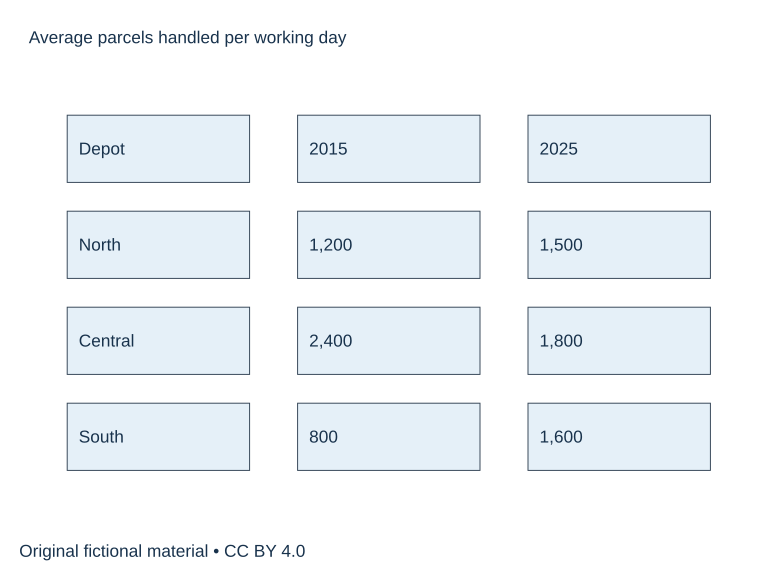

# SUP-W01 A图表概述与数据选择

原创专项，适合另择时段练习，实际用时待学习者记录。70分钟。先保留自己的首稿，再阅读独立参考页。

## 完整题面

The table shows the average number of parcels handled per working day by three delivery depots in 2015 and 2025. Summarise the information by selecting and reporting the main features, and make comparisons where relevant.

Write at least 150 words. Spend about 20 minutes.

数据可访问文本。North 2015年1200、2025年1500；Central 2400、1800；South 800、1600。单位为每工作日平均包裹件数，数据为原创虚构。

## 直接练习

先用两句概述写最大值、例外和排名变化，再选首尾与关键差值。避免把六个数机械排成六句。

首答20分钟、诊断与两段修订15、参考核查10、整篇重写20、归档5，共70分钟。

1. 圈出题干要求，写一行段落功能提纲，计入首答时段。
2. 完成全文并保留真实结束位置。
3. 在下方教学原稿中圈出问题，先独立修订，再核参考。

## 教学原稿待修

### 段落1

Overall, every depot handled more parcels. South was the busiest depot in 2025 because online shopping became popular.

你的修改____

依据____

### 段落2

South increased by 1,600 parcels. Central fell to 600 parcels, so the total number went down.

你的修改____

依据____

## 整篇重写与自查

在原稿中选择至多两项有证据的优先点，完整重写。无问题可换组织练迁移，并注明保留理由。

- [ ] 逐一回答题干要求并达到最低字数。
- [ ] 数据/角色设定/立场前后一致。
- [ ] 用两处原句说明修改或保留依据。
- [ ] 记录实际用时与仍需核实事项。

[完成后阅读参考](W01-reference.md)
