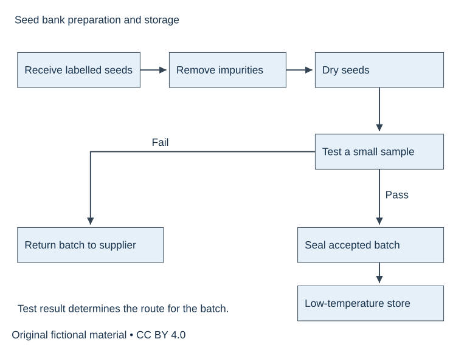
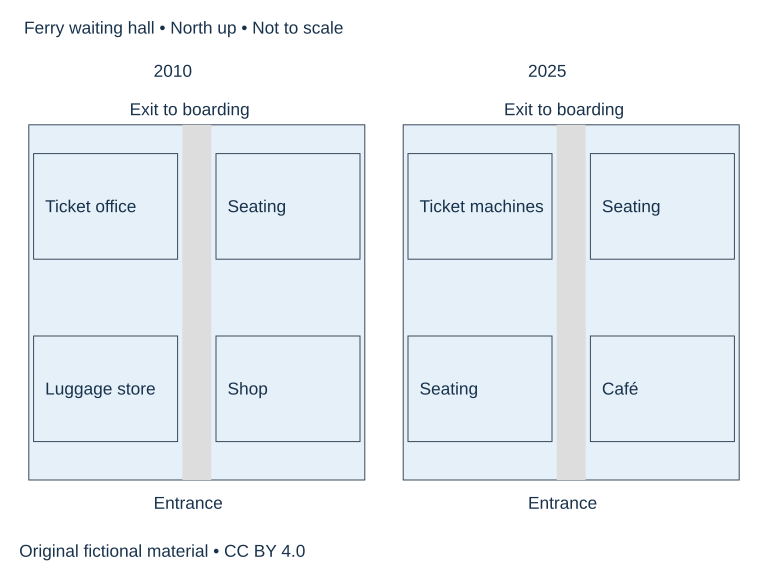

# SUP-W02 A流程与地图的两种组织

原创专项，适合另择时段练习，实际用时待学习者记录。140分钟。先保留自己的首稿，再阅读独立参考页。

## 完整题面

本工作坊分两次完成，每次70分钟，合计140分钟。两道完整Task 1分别练顺序与空间组织。

Task A. The diagram shows how a seed bank prepares seeds for long-term storage. Summarise the information by selecting and reporting the main features, and make comparisons where relevant. Write at least 150 words. Spend about 20 minutes.

完整数据。接收带标签种子→去杂质→干燥→从该批取少量样品做发芽测试；达标批次→装密封容器→低温储存；不达标批次→退还供种者。图未给温度、时长或测试阈值。

Task B. The plans show a ferry terminal waiting hall in 2010 and 2025. Summarise the information by selecting and reporting the main features, and make comparisons where relevant. Write at least 150 words. Spend about 20 minutes.

北向上。两年北中出口通登船区，南中入口，中央通道均保留。2010西北售票处、西南行李储存、东北座位、东南商店。2025西北自助售票机、西南座位、东北座位保留、东南咖啡店。外墙不变。

## 直接练习

流程先定起终点与分支，再按先后分组。地图先找保留基准，再按西/东组织变化。每个任务各写150词以上，分别完整重写。

首答20分钟、诊断与两段修订15、参考核查10、整篇重写20、归档5，共70分钟。
W02两题分别执行上述70分钟流程，合140分钟，可分两日。

1. 圈出题干要求，写一行段落功能提纲，计入首答时段。
2. 完成全文并保留真实结束位置。
3. 在下方教学原稿中圈出问题，先独立修订，再核参考。

## 教学原稿待修

### 段落1

The seeds are frozen for ten days and all of them are stored. If the sample fails, the seeds are dried again.

你的修改____

依据____

### 段落2

The terminal grew bigger. A new entrance was built in the north, and the shop moved to the west.

你的修改____

依据____

## 整篇重写与自查

在原稿中选择至多两项有证据的优先点，完整重写。无问题可换组织练迁移，并注明保留理由。

- [ ] 逐一回答题干要求并达到最低字数。
- [ ] 数据/角色设定/立场前后一致。
- [ ] 用两处原句说明修改或保留依据。
- [ ] 记录实际用时与仍需核实事项。

[完成后阅读参考](W02-reference.md)
